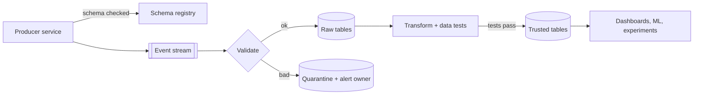

## The problem it solves

An engineer renames a column in their service's database. Overnight, the data pipeline that copies it breaks, the revenue dashboard shows zero, and an executive makes a decision on bad numbers before anyone notices. Downstream consumers of data often depend on details the producing team doesn't even know they expose.

## How it works

### Treat data as an interface

A **data contract** is an agreement between a data producer and its consumers, much like an API contract:

- **Schema:** fields, types, required or optional, allowed values.
- **Semantics:** what each field means ("`amount` is in minor units, after discounts, before tax").
- **Expectations:** freshness (lands within 1 hour), volume (roughly 1M rows/day), uniqueness.
- **Ownership:** who to contact, and how changes are announced.
- **Evolution rules:** which changes are allowed without coordination.

### Enforce schemas where data moves

For event streams, a **schema registry** (like Confluent Schema Registry for Kafka) stores versioned schemas (Avro, Protobuf or JSON Schema) and checks compatibility when producers register a new version, so a breaking change is rejected before it ships.

| Change | Backward compatible? |
|---|---|
| Add an optional field with a default | Yes |
| Remove an optional field | Usually, if consumers don't need it |
| Rename a field | No (it's a remove plus an add) |
| Change a type (string → int) | No |
| Change meaning without changing schema | No, and no tool will catch it |

Evolve breaking changes the same way as [schema migrations](/principles/zero-downtime-schema-migrations): add the new field, migrate consumers, then remove the old one.

### Test the data, not just the code

Tools like dbt let you declare tests on tables: `unique`, `not_null`, `accepted_values`, relationships between tables. Run them on every pipeline run and block bad data from reaching dashboards.

### Monitor data like a service

- **Freshness:** when did this table last update?
- **Volume:** a sudden 90% drop usually means something broke upstream.
- **Distribution:** null rates, value ranges, duplicates.
- **Lineage:** which dashboards and models depend on this table, so you know who's affected.

## Trade-offs

- **Rigor vs speed:** contracts and reviews slow down producers a little; broken dashboards and wrong decisions cost far more.
- **Where to enforce:** at the producer (best, prevents bad data) vs in the pipeline (catches more sources, but after the fact). Do both for critical data.
- **Alert fatigue:** test the things that matter; hundreds of flaky data tests get ignored.

## In the real world

Confluent's Schema Registry documents compatibility modes (backward, forward, full) that let Kafka producers and consumers evolve independently while rejecting breaking changes. dbt popularized declaring data tests next to transformation code so that data quality checks run like unit tests. The broader "data contracts" movement applies API discipline to data pipelines: producing teams publish deliberate, versioned datasets instead of exposing their internal database tables to everyone downstream.

## Interview angle

<Callout type="interview">
When a design feeds analytics or ML, say that events go through a schema registry with compatibility checks, that pipelines validate and quarantine bad records, and that critical tables are monitored for freshness and volume with clear owners.
</Callout>

<Callout type="tip" title="For PMs">
Ask "who owns this data, and who gets alerted when it's wrong?" for every metric that drives decisions. A dashboard without an owner and quality checks shouldn't be trusted for big calls.
</Callout>

- Analytics reading directly from a service's internal tables.
- Schema changes made without knowing who consumes the data.
- No freshness or volume monitoring on business-critical tables.
