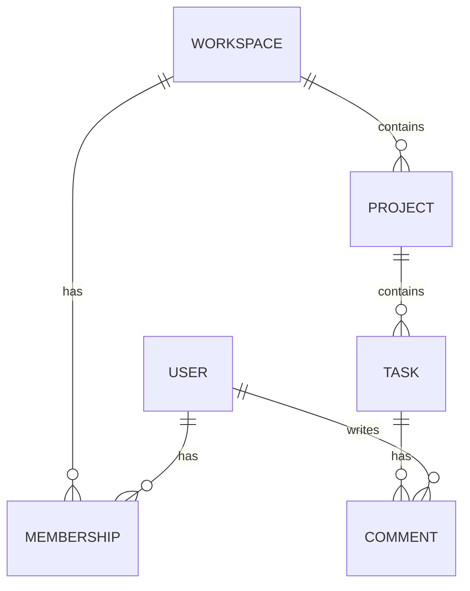

## The problem it solves

UIs get redesigned every year; services get rewritten; the data stays. A data model that doesn't match the product (a "team" bolted onto a schema built around individual users, an address stored as one text field, a status that can't represent a real-world case) makes every future feature slower to build and every report harder to trust.

## How it works

### 1. Start from the product's nouns and verbs

Read the product spec and user stories. Nouns are candidate **entities** (workspace, user, project, task, comment); verbs are **actions** that create or change them (invite, assign, complete).

### 2. Map relationships and cardinality

- A workspace has many projects (**one-to-many**).
- A user belongs to many workspaces, and a workspace has many users (**many-to-many**, needing a membership table with its own fields like `role` and `joined_at`).
- A task has one assignee, or maybe many? Ask now; changing one-to-one to one-to-many later touches every query.

### 3. Find the boundary of every tenant

In B2B products, almost everything belongs to a workspace, organization or account. Put that **tenant key on every row** from day one; it's what lets you enforce isolation, shard later and delete a customer's data cleanly. See [multi-tenant data isolation](/principles/multi-tenant-data-isolation).

### 4. Decide ownership

Each piece of data should have exactly **one owner** (one service or module) that writes it; others read through its API or consume its events. Martin Fowler's **bounded context** idea from domain-driven design helps: "customer" means different things to billing, support and shipping, and each context can have its own model, linked by IDs.

### 5. List the access patterns

Write down the queries with frequency and latency needs: "list a project's open tasks sorted by due date", "show a user's tasks across all workspaces". These decide indexes, denormalization and even database choice. See [data modeling and denormalization](/principles/data-modeling-and-denormalization) and [indexing](/principles/database-indexing).

### 6. Pin down the details that bite later

- **Identifiers:** what kind of IDs, exposed how? See [identifiers and keys](/principles/identifiers-and-keys).
- **Types:** time zones, money, enums, text. See [data types that bite](/principles/data-types-time-and-money).
- **Rules:** what must always be true? Encode it as [constraints](/principles/constraints-and-validation).
- **Lifecycle:** how is data deleted, archived or kept for audit? See [soft deletes and history](/principles/soft-deletes-audit-and-history).
- **Sensitivity:** which fields are personal or secret? See [PII and privacy](/principles/pii-privacy-and-retention).

### Default to a relational database

For most applications, a relational database with a normalized schema, foreign keys and a few well-chosen indexes is the right start: it enforces correctness and supports queries you haven't thought of yet. Move specific access patterns to other stores when measurements say so. See [SQL vs NoSQL](/principles/sql-vs-nosql).

## Trade-offs

- **Normalize vs denormalize:** start normalized for correctness; denormalize specific hot reads later.
- **Generic vs specific:** a generic "entities and attributes" schema feels flexible but makes every query and constraint hard. Model the real domain.
- **JSON columns:** great for truly variable, rarely queried data (integration payloads, user preferences); a trap for core fields you'll filter, join or validate on.

## In the real world

<Callout type="example" title="Notion: a tenant key made sharding possible">
Notion's data model keys blocks by workspace. When its single Postgres database ran out of headroom, the team could partition everything by workspace ID into 480 logical shards, because almost every query was already scoped to one workspace. See [How Notion sharded Postgres](/case-studies/notion-sharding-postgres).
</Callout>

Discord's messages table is the opposite lesson: designed from its access pattern, "latest messages in this channel", keyed by `(channel_id, bucket)`. See [Discord](/case-studies/discord-trillions-of-messages).

## Interview angle

<Callout type="interview">
Sketch the core entities and relationships, name the tenant or partition key, then list the top access patterns and show the keys and indexes that serve them. Say which service owns each entity.
</Callout>

<Callout type="tip" title="For PMs">
Engineers need answers to cardinality questions early: can a task have several assignees? Can a user belong to several organizations? Can an order have several shipments? Each "maybe later" is far cheaper to support now than to retrofit.
</Callout>

- Designing screens first and storing whatever each screen needs.
- No tenant key on rows in a B2B product.
- Two services writing the same table.
