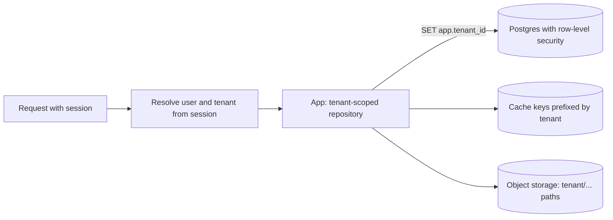

## The problem it solves

A B2B product serves thousands of companies from the same code and, usually, the same databases. A single missing `WHERE tenant_id = ?` in one query can expose one customer's data to another. A single large customer can slow down everyone else. And enterprise customers ask where their data lives and how it's separated.

## How it works

### Tenancy models

AWS's SaaS guidance describes a spectrum:

| Model | Data layout | Isolation | Cost and operations |
|---|---|---|---|
| **Pool** | Shared tables, every row has `tenant_id` | Logical; relies on correct filtering | Cheapest, simplest to operate at scale |
| **Bridge** | Shared database, schema per tenant | Medium | More objects to migrate |
| **Silo** | Database (or whole stack) per tenant | Strongest | Most expensive; many databases to run |

Many products mix them: pool for most customers, silo for the largest or most regulated ones who pay for it.

### Enforce isolation in layers

1. **Tenant on every row**, including join tables, and in every unique constraint (`UNIQUE (tenant_id, email)`).
2. **Tenant from the session, not the request body:** derive it from the authenticated user, never from a parameter a client can change. See [authorization](/principles/authentication-and-authorization).
3. **Scoped data access:** a repository layer or ORM scope that adds the tenant filter automatically, so engineers can't forget it.
4. **Database enforcement:** PostgreSQL **row-level security** policies restrict every query to rows matching the tenant set on the connection, so even a missing filter returns nothing.
5. **Everywhere else too:** cache keys, search indexes, object storage paths, queues, logs and analytics exports all need the tenant in them.
6. **Tests:** automated tests that try to read across tenants.

### Noisy neighbors

In a pool, one tenant's huge import can slow everyone. Use per-tenant [rate limits](/principles/rate-limiting) and quotas, separate queues for heavy work, and the ability to move large tenants to their own shard or [cell](/principles/cell-based-architecture).

### Tenant lifecycle

Plan for onboarding, plan changes, data export, and **offboarding**: deleting a tenant's data everywhere is much easier when every store is keyed by tenant.

## Trade-offs

- **Isolation vs cost:** silos are safest but multiply operational work (migrations across thousands of databases).
- **Row-level security:** strong safety net, but background jobs and admin tools must set the tenant explicitly, and policies add some query overhead.
- **Cross-tenant features:** marketplaces, shared channels between companies and admin analytics deliberately cross tenant lines; design those paths explicitly.

## In the real world

<Callout type="example" title="Shopify pods and Notion workspaces">
Shopify groups shops into **pods**, each with its own databases, so a problem or a flash sale in one pod doesn't affect shops in others. See [Shopify pods](/case-studies/shopify-pods). Notion partitions all data by workspace, which let it shard Postgres by workspace when it outgrew one database. See [Notion](/case-studies/notion-sharding-postgres).
</Callout>

## Interview angle

<Callout type="interview">
For any B2B design, state the tenancy model and how isolation is enforced: tenant from the session, tenant key on every row and cache key, row-level security as a backstop, and per-tenant limits for noisy neighbors. Mention how a large tenant could move to its own shard.
</Callout>

<Callout type="tip" title="For PMs">
Enterprise deals often hinge on isolation, data residency (which region data lives in) and data export or deletion on request. Find out which of these sales will promise, because each one shapes the architecture.
</Callout>

- Tenant ID taken from a request parameter.
- Cache keys without the tenant in them.
- No limits per tenant, so one customer can degrade everyone.
