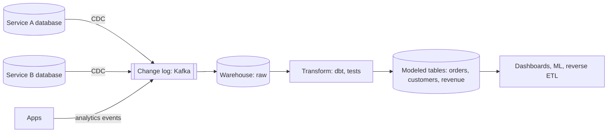

## The problem it solves

Someone runs a big reporting query against the production database at 10 a.m. and checkout slows to a crawl. Or analysts need data from ten services, each with its own database, and end up with fragile scripts and numbers that don't match. Operational and analytical workloads look similar (they're both "queries") but need very different systems.

## How it works

### Two kinds of workload

| | Operational (OLTP) | Analytical (OLAP) |
|---|---|---|
| Serves | The app and its users | Analysts, dashboards, ML |
| Queries | Small, by key, many per second | Large scans and aggregations |
| Latency | Milliseconds | Seconds to minutes |
| Data | Current state | History, from many sources |
| Storage | Row-oriented (Postgres, MySQL, DynamoDB) | Column-oriented (BigQuery, Snowflake, Redshift, ClickHouse) |
| Schema | Normalized for correct writes | Denormalized for easy analysis |

### Moving data from one to the other

- **Batch ETL/ELT:** copy tables nightly. Simple; data is up to a day old; full copies get expensive.
- **Change data capture (CDC):** tools like **Debezium** read the database's replication log and emit every insert, update and delete as an event. Near real time, no load from queries on the source, and nothing is missed.
- **Domain events:** services publish meaningful events (`OrderPlaced`) through the [outbox](/principles/transactional-outbox). Better semantics than raw row changes, and a cleaner contract.
- **Read replicas** for light reporting are a stopgap: they still use a row store and still share the schema.

### Model the warehouse for questions

Raw copies of service tables are hard to analyze and fragile. Transform them into well-defined, tested tables with business meaning (orders, customers, daily revenue), owned and documented. See [data contracts and quality](/principles/data-contracts-and-quality).

## Trade-offs

- **Freshness vs cost and complexity:** nightly batch is simple; streaming CDC is fresh but is another system to run.
- **Raw changes vs domain events:** CDC captures everything automatically but couples consumers to internal schemas; events are deliberate contracts but require producers to emit them.
- **Single source of truth:** when the warehouse and the app disagree, the app's database wins for operational facts; reconcile regularly.

## In the real world

<Callout type="example" title="LinkedIn: the log as the integration point">
LinkedIn's engineers described replacing a tangle of point-to-point data pipelines between databases, search, the warehouse and monitoring with a single **log** (Kafka) that every system writes changes to and reads from. Each new system only needs one integration, and every consumer sees the same ordered changes. See [LinkedIn, Kafka and the log](/case-studies/linkedin-kafka-and-the-log).
</Callout>

## Interview angle

<Callout type="interview">
If a design needs reporting, analytics or ML features, don't query the production database: stream changes via CDC or events into a log and a warehouse, and say how fresh the data needs to be.
</Callout>

<Callout type="tip" title="For PMs">
Ask how fresh each dashboard needs to be; "real time" analytics costs much more than hourly or daily. And make sure product metrics are computed from modeled, tested tables, not ad hoc queries on production.
</Callout>

- Heavy reporting queries on the primary database.
- Analysts depending on raw internal tables that change without notice.
- Two dashboards computing the same metric differently.
