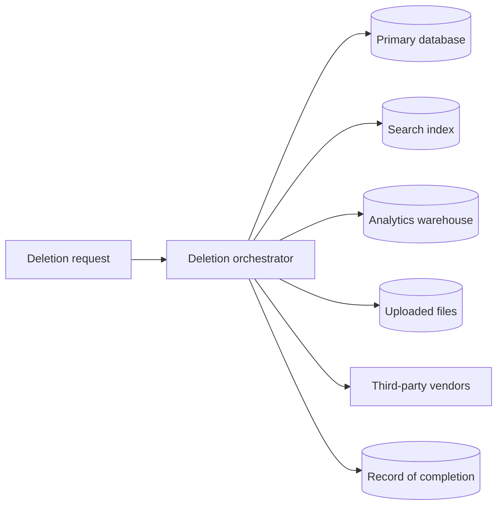

## The problem it solves

Personal data spreads: from the production database into logs, analytics, backups, support tools, spreadsheets and third-party services. When a user asks to be deleted, or a breach happens, or a regulator asks what you hold, teams discover they don't know where it all is. Every copy is a liability.

## How it works

### Principles (from GDPR Article 5)

GDPR's core principles are good engineering rules even outside Europe:

- **Data minimization:** collect only what you need for a stated purpose.
- **Purpose limitation:** don't reuse data for unrelated purposes without a basis.
- **Storage limitation:** keep it no longer than necessary.
- **Integrity and confidentiality:** protect it with appropriate security.
- **Accuracy and accountability:** keep it correct and be able to show compliance.

### Classify your data

Tag fields by sensitivity in the schema or a data catalog:

| Class | Examples | Handling |
|---|---|---|
| Public | Product names, published posts | Normal |
| Internal | Usage metrics, internal IDs | Access-controlled |
| Personal (PII) | Name, email, IP address, location | Minimize, access logs, deletable |
| Sensitive | Health, financial, government IDs, precise location | Encrypt at field level, strict access, extra legal rules |
| Secrets | Passwords, tokens, keys | Hash or vault; never logged. See [secrets](/principles/secrets-and-config-management) |

### Keep PII out of places it doesn't belong

- **Logs:** log user IDs, not emails or request bodies; scrub before writing.
- **Analytics:** send pseudonymous IDs; see [analytics event design](/principles/analytics-event-design).
- **Non-production:** never copy raw production data into dev or staging; use synthetic or masked data.
- **Third parties:** know which vendors receive what.

### Design deletion from the start

The **right to erasure** (GDPR Article 17) means deleting a user's personal data on request, with some exceptions such as legal obligations. That's easy only if you can find it:

- Key personal data by user ID everywhere so it can be found.
- Publish a "user deleted" event that every system handles.
- **Crypto-shredding:** encrypt each user's sensitive data with a per-user key; deleting the key makes copies in backups unreadable.
- **Retention policies:** delete or anonymize data automatically after a period (e.g. raw logs after 30 days).

## Trade-offs

- **Data value vs risk:** more data enables features and analysis, and increases breach impact and compliance work.
- **Anonymization is hard:** removing names isn't enough; combinations of location, time and behavior can re-identify people. Aggregate where possible.
- **Deletion vs other duties:** financial records may have to be kept for years; separate what must be retained from what can be deleted.

## In the real world

GDPR (EU, 2018) and laws like California's CCPA made these principles legal requirements with significant fines, and enterprise customers now routinely ask about data residency, retention, subprocessors and deletion in security reviews. Many companies have learned the cost of retrofitting: finding personal data across years of logs, warehouses and backups after the fact is a multi-quarter project.

## Interview angle

<Callout type="interview">
When your design stores personal data, mention minimization, encryption of sensitive fields, keeping PII out of logs and analytics, and a deletion path that reaches every store, keyed by user ID. It's rarely asked for and almost always appreciated.
</Callout>

<Callout type="tip" title="For PMs">
For each new field you ask to collect, write down why it's needed and how long it should be kept. Ask legal early about which regions' rules apply. Make "how do we delete this?" part of the spec.
</Callout>

- Emails and request bodies in logs.
- Production data copied into staging.
- No way to find all of a user's data when they ask to be deleted.
