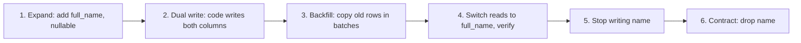

## The problem it solves

During a deploy, old and new versions of your code run at the same time, and both talk to the same database. Rename a column in one step and the old code breaks instantly. On a large table, even adding an index or a column can lock the table for minutes and take the site down.

## How it works

### Rule: every step must work with both the old and the new code

Use **expand and contract** (Martin Fowler calls it *parallel change*). Example: rename `users.name` to `users.full_name`.

Each step is a separate deploy that can be rolled back. You can pause between steps for days; the system is consistent at every point.

### Safe and unsafe operations

| Usually safe | Needs care |
|---|---|
| Add a nullable column | Rename or drop a column (expand/contract) |
| Add a table | Add `NOT NULL` to an existing column (backfill first; validate constraints separately where the database supports it) |
| Create an index concurrently (`CREATE INDEX CONCURRENTLY` in Postgres) | Change a column's type (often rewrites the table) |
| Add a column with a constant default (modern Postgres) | Large backfills in one transaction |

Database-specific details matter: check what locks each operation takes in your database and version before running it on a large table.

### Backfills

- Run in small batches (e.g. 1,000 rows), with pauses, so you don't overload the primary or replicas.
- Make them idempotent and resumable; they will be interrupted.
- Verify: compare counts and sample rows between old and new before switching reads.

### Online schema change tools

For MySQL, tools like **gh-ost** (GitHub) and pt-online-schema-change build a copy of the table with the new schema, copy rows in the background while capturing ongoing changes, then swap tables in a brief cut-over. GitHub built gh-ost because it ran schema changes several times a day and needed them to be pausable, controllable and light on the primary.

## Trade-offs

- **Speed vs safety:** expand/contract takes several deploys instead of one; it's the price of never breaking production.
- **Temporary complexity:** dual writes and two columns live in the code for a while. Track the contract step so it actually happens.
- **Rollbacks:** once you've dropped a column, you can't roll back the code that used it. Contract only after the new path has run cleanly for a while, and have backups.

## In the real world

<Callout type="example" title="Stripe's four-step migration">
Stripe described moving subscription data out of the customer record into its own table, live, at very large scale. The pattern: **dual write** to old and new, **change reads** to the new location, **change writes** to only the new location, then **remove** the old data. Each phase was verified before moving on, and the old path was kept until the new one was proven.
</Callout>

Notion's sharding migration followed the same shape at a larger scale: double writes, a backfill, verification, then a short switchover. See [How Notion sharded Postgres](/case-studies/notion-sharding-postgres).

## Interview angle

<Callout type="interview">
If your design changes an existing schema or moves data, describe expand/contract: add the new structure, dual write, backfill in batches, verify, switch reads, then remove the old. Mention that old and new code run concurrently during deploys.
</Callout>

<Callout type="tip" title="For PMs">
A "simple" rename or restructure of core data can take several releases to do safely. Ask engineering how many steps a data change needs and plan the roadmap around it rather than expecting it in one sprint.
</Callout>

- Renaming or dropping columns in a single deploy.
- Backfilling millions of rows in one transaction.
- Never doing the contract step, leaving dead columns forever.
