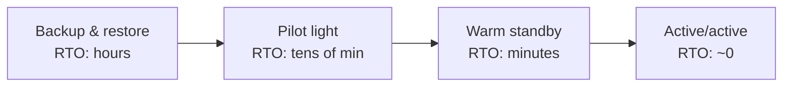

## The problem it solves

Replication protects you from a machine dying. It doesn't protect you from a person or bug **deleting or corrupting data**, because the deletion replicates instantly. It also doesn't help if an entire region becomes unavailable. Backups and disaster recovery cover the failures replication can't.

## How it works

### Two numbers drive everything

- **RPO (recovery point objective):** the maximum acceptable data loss, measured in time. "RPO = 5 minutes" means losing at most the last 5 minutes of writes.
- **RTO (recovery time objective):** the maximum acceptable downtime before service is restored.

### Backup building blocks

- **Full snapshots** (daily or hourly), plus **continuous logs** (WAL or binlog archiving) enable **point-in-time recovery**: restore the snapshot, then replay the log up to just before the bad command.
- **Logical backups** (SQL dumps) are portable but slow for large databases.
- **The 3-2-1 rule:** three copies, on two kinds of storage, one off-site. Modern versions add an **immutable** copy that can't be deleted even with admin credentials, which protects against ransomware and mistakes.
- **Different account or region:** a backup in the same account as production can be deleted by the same compromised credentials.

### DR strategies, cheapest to fastest

| Strategy | What runs in the recovery region | RTO | Cost |
|---|---|---|---|
| **Backup and restore** | Nothing; restore from backups | Hours | Lowest |
| **Pilot light** | Data replicated, core services off or minimal | Tens of minutes | Low |
| **Warm standby** | A scaled-down full copy, running | Minutes | Medium |
| **Multi-site active/active** | Full production in each region | Near zero | Highest |

## Trade-offs

- **Faster recovery costs more:** active/active roughly doubles infrastructure and adds data-consistency complexity.
- **Restores take longer than you think.** Restoring terabytes can take hours; measure it, and include it in your RTO.
- **Untested backups are not backups.** Configuration drift, missing permissions or silently failing jobs are only discovered during a restore.
- **Failover should rely on simple, pre-provisioned steps.** AWS's guidance is to depend only on data-plane operations during failover, not on control-plane APIs that may be impaired in the same disaster. See [static stability](/principles/static-stability).

## In the real world

<Callout type="example" title="GitLab 2017: five backup methods, none working">
In January 2017, an engineer at GitLab.com, while fighting a replication problem late at night, ran a directory deletion on the primary database server instead of the replica. About 300 GB of production data was removed. The team then discovered that their regular backups had been failing silently, and other mechanisms weren't usable either. They recovered from an LVM snapshot taken about six hours earlier, losing six hours of issues, merge requests and comments, and livestreamed the recovery. Afterwards GitLab added monitoring for backups and regular restore testing.
</Callout>

AWS's disaster recovery whitepaper frames the choice the same way: start from the business's RPO and RTO for each workload, pick the cheapest strategy that meets them, and remember that replication alone doesn't protect against corruption, so point-in-time backups are still needed.

## Interview angle

<Callout type="interview">
State RPO and RTO for the critical data ("RPO 1 minute, RTO 15 minutes for orders"), then pick the matching strategy: point-in-time recovery from continuous log archiving, plus a warm standby in another region. Mention that you'd test restores regularly.
</Callout>

- Calling replicas backups.
- Backups stored with the same credentials as production.
- Never testing a restore.
