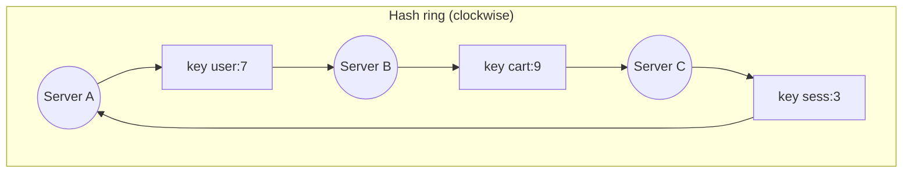

## The problem it solves

The simplest way to spread keys over N cache or database servers is `server = hash(key) mod N`. It distributes well, until N changes. Going from 10 to 11 servers changes the answer for about 90% of keys. For a cache, that means nearly every lookup misses at once, and the database behind it gets flattened. For a database, it means moving almost all the data.

## How it works

1. Hash every server onto a circle of positions (say 0 to 2³² − 1).
2. Hash each key onto the same circle.
3. A key belongs to the **first server clockwise** from its position.

When server D is added between B and C, only the keys between B and D move (from C to D). Everything else stays put. On average, adding or removing one of N servers moves about **1/N** of the keys.

### Virtual nodes

With only a few servers, their positions on the ring are uneven, and one might own a much bigger arc than another. The fix is to give each physical server many positions (**virtual nodes**, often 100–256). Load evens out, and when a server leaves, its keys scatter across all the others rather than piling onto one neighbour. Servers with more capacity can simply get more virtual nodes.

### Replication on the ring

To store N copies, walk clockwise and place a replica on each of the next N distinct physical servers. Dynamo calls this list the key's **preference list**.

### Alternatives

- **Rendezvous (highest random weight) hashing:** for each key, score every server with `hash(key, server)` and pick the highest. Simple, with minimal movement, but O(N) per lookup.
- **Jump consistent hash** (Google, 2014): a few lines of arithmetic, no memory, perfectly even, but servers can only be added or removed at the end of a numbered list. Good for sharded storage with numbered shards.
- **Maglev hashing:** builds a lookup table for fast, even, minimally disruptive balancing. Used in Google's load balancers.

## Trade-offs

- **Uneven load without virtual nodes.** And even with them, a hot *key* still lands on one server; hashing can't split a single celebrity.
- **Membership must agree.** Every client must have the same view of which servers are on the ring, or they'll route the same key differently. Systems use gossip or a coordination service.
- **Data still has to move.** Minimal movement isn't zero; rebalancing needs throttling so it doesn't overload the cluster.

## In the real world

<Callout type="example" title="Amazon Dynamo">
Dynamo partitions data with consistent hashing and virtual nodes, which lets Amazon add capacity one node at a time and spread a failed node's load across many others. Cassandra, Riak and many caching client libraries adopted the same design.
</Callout>

Discord routes requests for a channel to the same data-service instance using consistent hashing on the channel ID, which is what lets it coalesce duplicate requests for hot channels. See [How Discord stores trillions of messages](/case-studies/discord-trillions-of-messages).

## Interview angle

<Callout type="interview">
When your design has a sharded cache or database, explain why `hash mod N` breaks on resize and that you'd use consistent hashing with virtual nodes, or a fixed number of logical shards. Then mention hot keys as the problem hashing doesn't solve.
</Callout>

- Forgetting virtual nodes.
- Assuming consistent hashing also fixes hot keys.
