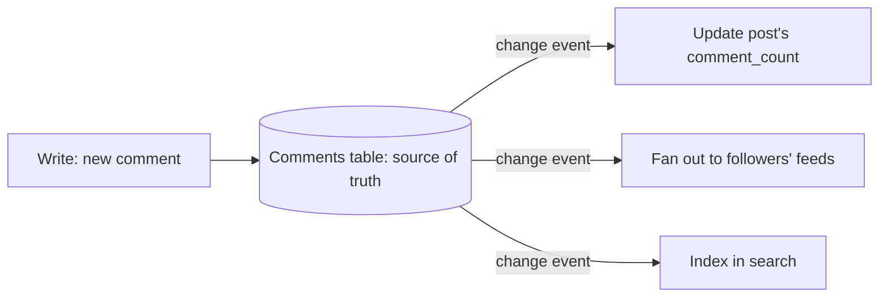

## The problem it solves

A textbook schema with no duplicated data is easy to keep correct, but a product page that needs 8 joins across 6 tables is slow, and impossible once those tables live on different shards. Modeling decides how much you pay at write time to make reads cheap.

## How it works

### Normalized

Each fact lives in exactly one place. Orders reference customers by ID; the customer's name is stored once.

- **Pros:** no update anomalies; flexible queries; less storage.
- **Cons:** reads need joins; joins don't work across shards or in most NoSQL stores.

### Denormalized

Copy data to where it's read. Store the author's name and avatar on every comment; keep a precomputed `follower_count` on the user row; materialize each user's timeline.

- **Pros:** one lookup per read; scales horizontally.
- **Cons:** every change must update every copy; copies drift if an update is missed.

### Model for the access pattern

At scale, start from the queries, not the entities:

1. List the access patterns with their frequency and latency targets ("load a channel's latest 50 messages: 50k/s, p99 < 50 ms").
2. Design keys so the most important patterns are single-partition lookups or range scans.
3. Duplicate data where needed to serve each pattern; decide which copy is the source of truth.
4. Keep copies in sync with transactions (same partition), change data capture, or events.

### Patterns

- **Precomputed aggregates:** counters and totals updated on write.
- **Materialized views:** query results stored and refreshed, either by the database or a pipeline.
- **Fan-out on write:** push each new post into every follower's feed list; reads are one lookup. Expensive for accounts with millions of followers, so many systems mix it with fan-out on read for celebrities.
- **Single-table design (DynamoDB):** store several entity types in one table with composite keys so related items share a partition and come back in one query.

## Trade-offs

| | Normalize | Denormalize |
|---|---|---|
| Reads | More work | Cheap |
| Writes | Cheap | Fan out to copies |
| Correctness | Easy | Needs sync strategy |
| New queries | Easy to add | May need a new copy |

Denormalized data should be **derivable**: if a copy gets corrupted, you can rebuild it from the source of truth.

## In the real world

<Callout type="example" title="Discord: the table is the query">
Discord's messages table is keyed by `(channel_id, bucket)` with messages sorted by a time-ordered ID inside each partition. That shape exists for exactly one query, "the latest messages in this channel", which it serves as a single-partition read. Other questions, like searching messages, are served by separate systems built for them. See [How Discord stores trillions of messages](/case-studies/discord-trillions-of-messages).
</Callout>

AWS's DynamoDB guidance takes the same position: identify access patterns before designing a table, keep related items together under one partition key, and accept duplication to avoid joins, which DynamoDB doesn't support.

## Interview angle

<Callout type="interview">
List your top 3 access patterns first, then show the key design that serves each one. If you duplicate data, say which copy is authoritative and how the others are updated (same transaction, change data capture, or async events) and what happens if an update is lost.
</Callout>

- Designing tables before listing queries.
- Denormalizing without a way to rebuild or reconcile copies.
- Fan-out on write for accounts with millions of followers.
