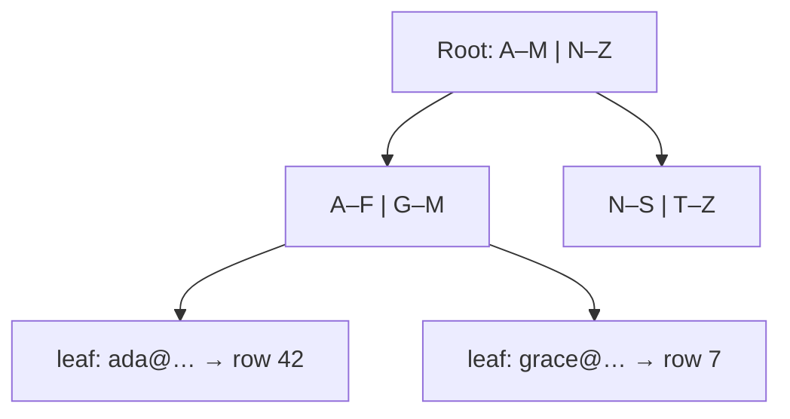

## The problem it solves

Without an index, finding `WHERE email = 'ada@example.com'` means reading every row in the table. That's fine for a thousand rows and catastrophic for a hundred million. Missing indexes are the most common cause of a database that suddenly "can't keep up".

## How it works

An index is a separate data structure, usually a **B-tree**, that keeps a column's values sorted with pointers to the rows. A lookup walks from the root to a leaf in a handful of steps, even for billions of rows, because each node holds hundreds of keys.



### Kinds of index you'll use

- **Single-column:** `CREATE INDEX ON users (email);`
- **Unique:** enforces that no two rows share a value and doubles as a fast lookup.
- **Composite:** `CREATE INDEX ON orders (customer_id, created_at);` supports queries on `customer_id` alone, or `customer_id` plus a range or sort on `created_at`. It does **not** help a query on `created_at` alone: the leftmost column has to be used.
- **Covering:** includes every column the query needs, so the database never touches the table (an "index-only scan").
- **Partial:** indexes only some rows, e.g. `WHERE status = 'pending'`, keeping it small.
- **Specialized:** hash, GIN for full-text and JSON, GiST for geospatial, and vector indexes for embeddings.

### Read the query plan

`EXPLAIN ANALYZE` shows whether the database used an index or scanned the table, and how long each step took. Make it a habit for any query that runs on a hot path.

```sql
EXPLAIN ANALYZE
SELECT id, total FROM orders
WHERE customer_id = 123
ORDER BY created_at DESC
LIMIT 20;
-- Index Scan using orders_customer_id_created_at_idx ... (actual time=0.04..0.09 rows=20)
```

## Trade-offs

- **Every index slows writes.** Each insert or update must update every index on the table. Write-heavy tables should carry only the indexes their queries need.
- **Indexes take space and memory.** They work best when the hot part fits in RAM.
- **Low-selectivity columns rarely help.** An index on a boolean column usually isn't used, because reading half the table through an index is slower than a scan.
- **Functions defeat indexes.** `WHERE lower(email) = …` can't use an index on `email`; create an expression index or store the normalized value.
- **Building an index on a big live table locks or loads it.** Use online options (`CREATE INDEX CONCURRENTLY` in Postgres) or tools that build in the background.

## In the real world

<Callout type="example" title="Indexes as a scaling strategy">
Stack Overflow's architecture write-ups describe a site that runs on a small number of SQL Server machines, made possible largely by careful indexing and query tuning, plus heavy caching. Before adding servers or shards, check whether the slow query just needs the right composite index: it's the cheapest scaling work there is.
</Callout>

## Interview angle

<Callout type="interview">
When you define a table, name the queries it serves and the index for each: "feed reads by user and newest first, so an index on (user_id, created_at DESC)". Mention the write cost if the table is write-heavy.
</Callout>

- Indexing every column "just in case".
- A composite index in the wrong column order for the query.
- Forgetting that a cache doesn't fix a slow query on a cache miss.
