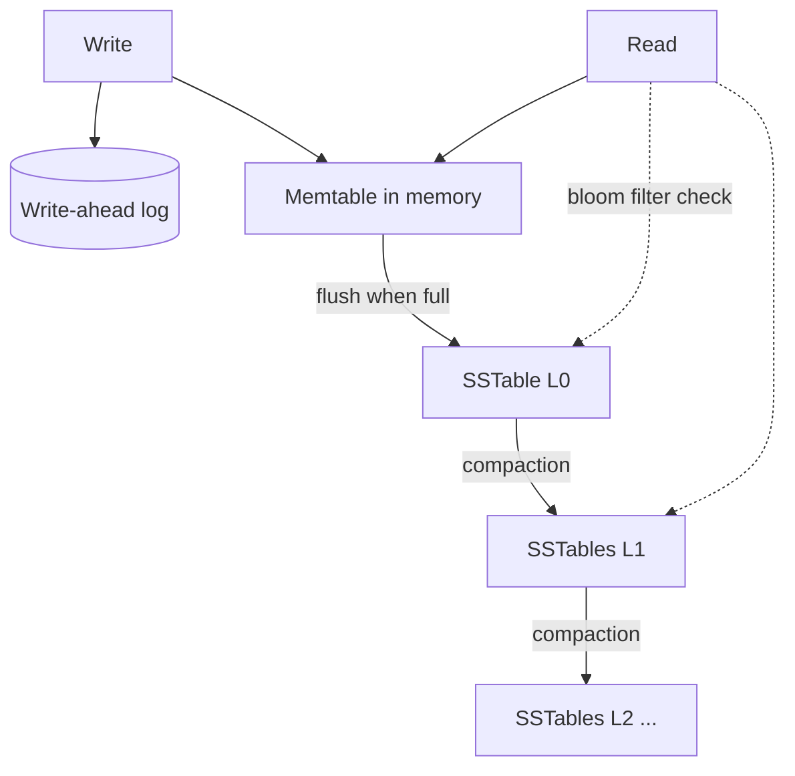

## The problem it solves

Every database sits on a storage engine that decides how bytes are laid out on disk. That choice sets how fast writes can go, how fast reads are, how much space is wasted, and where latency spikes come from. Knowing the two main designs explains why Postgres and Cassandra behave so differently.

## How it works

### B-trees (in-place updates)

Used by PostgreSQL, MySQL InnoDB, SQL Server and most relational databases.

- Data lives in fixed-size pages (often 8–16 KB) arranged as a balanced tree.
- A write finds the right leaf page and modifies it **in place**, after first recording the change in a write-ahead log (WAL) for crash safety.
- A read walks root → leaf: a few page reads, usually cached in memory.

### LSM trees (log-structured merge)

Used by Cassandra, ScyllaDB, RocksDB, LevelDB, HBase and Bigtable.

1. Writes go to the **WAL** (for durability) and an in-memory sorted table (the **memtable**). That's it: very fast.
2. When the memtable fills, it's flushed to disk as an immutable sorted file (an **SSTable**).
3. Reads check the memtable, then SSTables from newest to oldest. **Bloom filters** let a read skip files that definitely don't contain the key.
4. **Compaction** runs in the background, merging SSTables, discarding overwritten values and deleted entries (tombstones).

## Trade-offs

| | B-tree | LSM tree |
|---|---|---|
| Write throughput | Good; random writes to pages | Excellent; sequential appends |
| Point reads | Excellent and predictable | Good; may check several files |
| Range scans | Excellent | Good, after merging files |
| Space | Some fragmentation | Temporary duplicates until compaction |
| Latency spikes | Rare | Compaction and flushes can cause spikes |
| Deletes | Immediate | Tombstones linger until compacted |

Three kinds of amplification frame the trade-off: **write amplification** (bytes written to disk per byte of data), **read amplification** (disk reads per query) and **space amplification**. You can't minimize all three at once; LSM compaction strategies (leveled vs size-tiered) pick different points.

## In the real world

<Callout type="example" title="Discord: when compaction falls behind">
Discord's Cassandra cluster suffered when compaction couldn't keep up. Uncompacted SSTables made reads more expensive, which slowed nodes further, so they had to take nodes out of rotation to let compaction catch up. Combined with JVM garbage-collection pauses, this drove unpredictable tail latency, and was a key reason Discord moved to ScyllaDB, another LSM-based store whose C++ shard-per-core design handles compaction and memory without a garbage collector.
</Callout>

RocksDB, built at Facebook from Google's LevelDB, is an embeddable LSM engine tuned for flash storage. It powers storage in many systems, including MyRocks, a MySQL storage engine Facebook built to cut storage space compared with InnoDB's B-trees.

## Interview angle

<Callout type="interview">
If your design has a very high write rate (metrics, logs, messages, events), mention that an LSM-based store suits it, and that you'd monitor compaction. For read-heavy transactional data with complex queries, a B-tree relational database is the natural fit.
</Callout>

- Assuming deletes in an LSM store free space immediately.
- Ignoring compaction when capacity planning.
