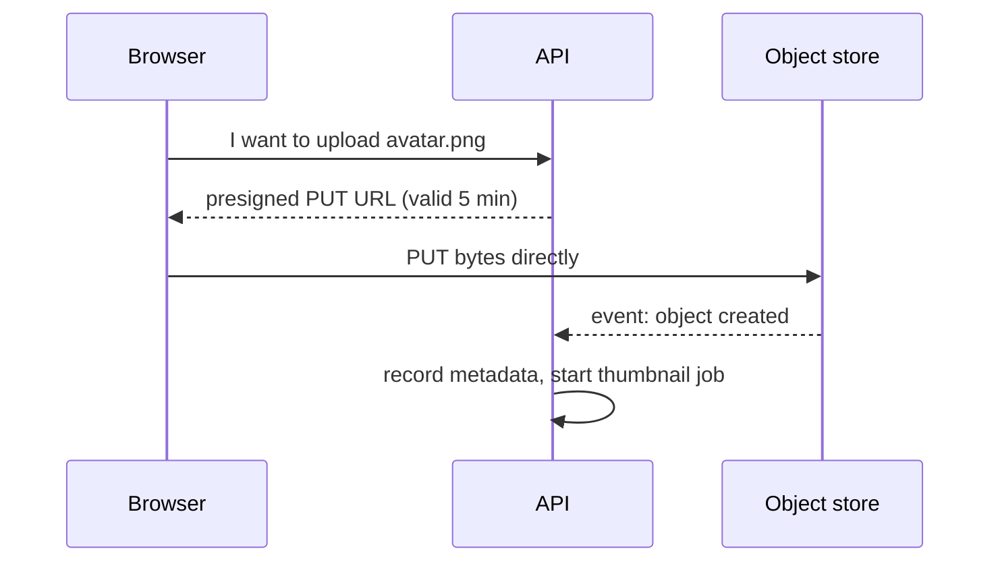

## The problem it solves

User uploads, video files, logs, backups and ML datasets don't belong in a relational database: they're large, written once, read many times, and grow without bound. Storing them on app servers' disks breaks [statelessness](/principles/stateless-services) and loses data when a server dies.

## How it works

An object store holds **objects** (bytes plus metadata) in **buckets**, addressed by key:

```text
PUT    https://bucket.s3.amazonaws.com/users/42/avatar.png
GET    https://bucket.s3.amazonaws.com/users/42/avatar.png
LIST   ?prefix=users/42/
DELETE https://bucket.s3.amazonaws.com/users/42/avatar.png
```

- **No real directories:** keys are flat strings; `/` is just a convention, and listing by prefix simulates folders.
- **Immutable objects:** you replace a whole object rather than editing bytes in the middle.
- **Durability by redundancy:** data is split and spread across many disks and facilities using replication or **erasure coding** (split into k data pieces plus m parity pieces; any k can rebuild the object). S3 is designed for 99.999999999% (11 nines) durability.
- **Storage tiers:** frequently accessed, infrequent, and archive classes, with lifecycle rules that move or delete objects by age.

### Common patterns

- **Presigned URLs:** the backend signs a short-lived URL so the browser uploads or downloads directly from the object store, keeping big files off your servers.
- **CDN in front:** serve public objects through a [CDN](/principles/cdn-and-edge-caching).
- **Metadata in a database:** keep the object key, owner, size and status in your database; keep the bytes in object storage.
- **Multipart upload:** large files are uploaded in parallel chunks and can resume after failures.
- **Event notifications:** a new object triggers a function or queue message, for example to generate thumbnails.



## Trade-offs

- **Latency per request is higher** than local disk (tens of milliseconds), so it's not for small, frequent random reads. Batch small items or cache them.
- **No partial updates or appends** in standard object stores; design for write-once objects.
- **Costs come from requests and egress, not just storage.** Millions of tiny objects or heavy internet downloads can cost more than the bytes themselves.
- **Listing is slow at scale.** Don't use LIST as a database query; keep an index in your database.

## In the real world

<Callout type="example" title="S3's consistency upgrade">
Until December 2020, S3 was eventually consistent for overwrites and deletes, so systems built on it (especially data lakes) needed workarounds to avoid reading stale listings. AWS then made S3 strongly consistent for all reads, writes and lists. Werner Vogels's write-up explains that the change came from adding a cache-coherence protocol to S3's metadata layer, not from slowing every request down.
</Callout>

Dropbox stored its users' files on S3 for years, then built **Magic Pocket**, its own exabyte-scale object store, and in 2016 moved the vast majority of user data into it. At that scale, owning the storage stack gave Dropbox more control over performance and much better economics, which it describes in its Magic Pocket blog series.

## Interview angle

<Callout type="interview">
For any media upload, say: "Clients upload directly to object storage with a presigned URL; we store metadata in the database; a CDN serves reads; an upload event triggers processing." That one sentence covers most photo or video designs.
</Callout>

- Storing blobs in the relational database.
- Proxying large uploads through app servers.
- Using LIST to answer user-facing queries.
