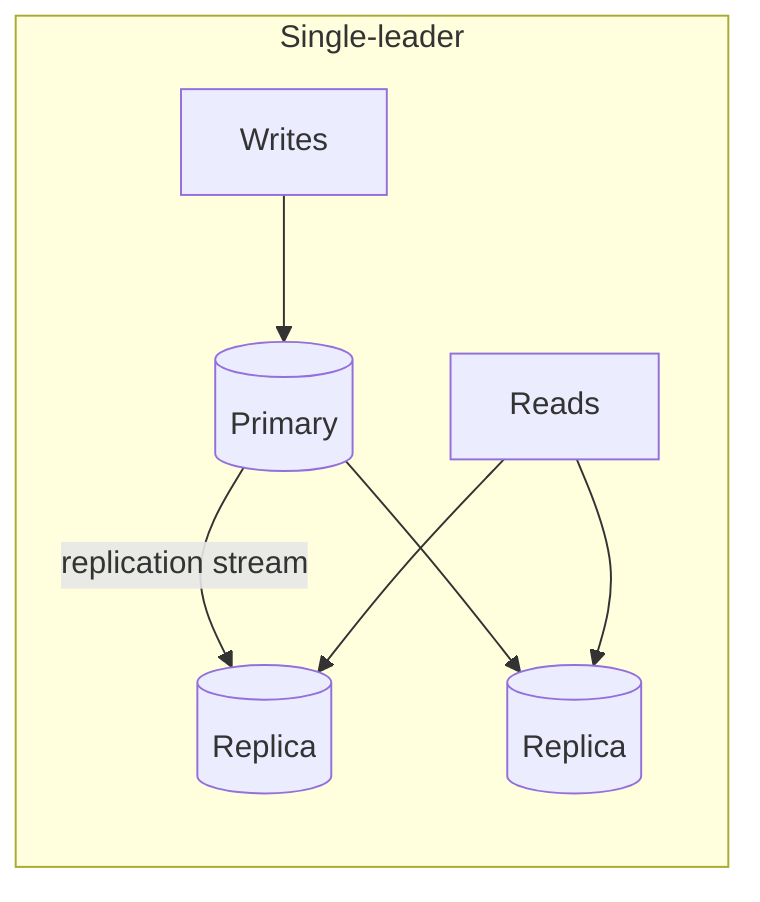

## The problem it solves

A single database server is a single point of failure, a ceiling on read capacity and, if its disk dies, a source of data loss. Keeping copies on other machines solves all three, but introduces a new question: what happens when the copies disagree?

## How it works

### Topologies

**Single-leader (primary/replica).** One node accepts writes and streams changes to followers. Followers serve reads. This is the default in PostgreSQL, MySQL and most managed databases.

**Multi-leader.** Several nodes accept writes, often one per region, and replicate to each other. Writes are fast everywhere, but concurrent writes to the same row conflict and must be resolved.

**Leaderless.** Clients write to several replicas directly and read from several, using [quorums](/principles/quorums) (W + R > N) to see the latest value. Used by Dynamo-style stores such as Cassandra and Riak.

### Synchronous vs asynchronous

- **Synchronous:** the primary waits for a replica to confirm before acknowledging. No acknowledged write is lost if the primary dies, but every write pays the round trip, and a slow replica stalls writes.
- **Asynchronous:** the primary acknowledges immediately. Fast, but if it fails, the last few writes that hadn't replicated are lost.
- **Semi-synchronous:** wait for *one* replica, stream to the rest asynchronously. A common compromise.

### Replication lag

Async followers fall behind, usually by milliseconds, sometimes by minutes under load. Lag causes the classic bugs: a user saves a profile, reloads, reads from a lagging replica and sees the old version. Fixes include reading your own writes from the leader, pinning a session to one replica, or waiting until a replica has caught up to the version the client last wrote. See [consistency models](/principles/consistency-models).

### Failover

When the primary dies, a replica must be promoted, clients must be pointed at it, and the old primary must be prevented from accepting writes if it comes back. Automating this safely is hard: promote too eagerly and a network blip triggers needless failovers or [split brain](/principles/split-brain-and-fencing); too cautiously and downtime stretches out.

## Trade-offs

| | Single-leader | Multi-leader | Leaderless |
|---|---|---|---|
| Write scaling | One node | One per leader | All nodes |
| Conflicts | None | Must resolve | Must resolve |
| Consistency | Strong possible | Weak | Tunable |
| Failover | Needed | Partial | Not needed |

Replication is **not a backup**. A bad `DELETE` or a corrupting bug replicates to every copy within milliseconds. See [backups and disaster recovery](/principles/backups-and-disaster-recovery).

## In the real world

<Callout type="example" title="GitHub: automated MySQL failover across data centers">
GitHub's MySQL fleet uses single-primary clusters. Its engineering blog describes how failover works: **orchestrator** detects a dead primary and promotes a replica, orchestrator itself runs as a Raft cluster so it can survive failures, and Consul plus GLB/HAProxy route clients to the new primary. HAProxy is configured to cut connections to the old primary quickly, guarding against split brain without needing client cooperation.
</Callout>

Even well-designed failover can surprise you. In October 2018, a 43-second network partition led orchestrator to promote primaries in a different region, which GitHub's application tier couldn't handle, causing about 24 hours of degraded service. GitHub then changed orchestrator's configuration to stop promoting primaries across regional boundaries.

## Interview angle

<Callout type="interview">
For any database in your design, state the replication setup: "single primary with two async replicas in other zones, reads from replicas except right after a user's own write, automated failover with fencing". Then say what you lose in a failover (a few seconds of async writes) and whether that's acceptable for this data.
</Callout>

- Treating replicas as backups.
- Reading from replicas without handling lag.
- Ignoring how clients find the new primary after failover.
