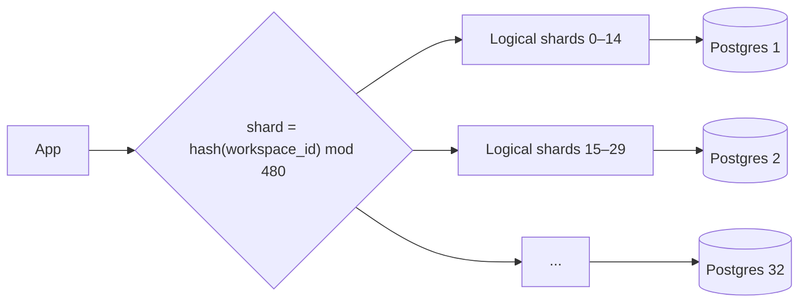

## The problem it solves

Replication helps reads, but every write still goes to one primary, and the whole dataset still has to fit on one machine. When the write rate, the data size or maintenance tasks like vacuuming outgrow the biggest server you can buy, you have to split the data itself.

## How it works

Each row is assigned to one shard based on a **shard key**. Each shard is an independent database (usually with its own replicas) holding a subset of the data.

### Strategies

| Strategy | How | Good | Watch out |
|---|---|---|---|
| **Range** | Key ranges: A–F, G–M… or by date | Range scans are cheap | Hot spots: all new writes hit the latest range |
| **Hash** | `hash(key) mod N` | Even spread | Range queries hit every shard; changing N moves most keys |
| **Consistent hash** | Keys and nodes on a ring | Adding a node moves ~1/N of keys | More complex. See [consistent hashing](/principles/consistent-hashing) |
| **Directory / lookup** | A table maps key → shard | Flexible moves | The directory is a dependency to keep fast and available |

### Logical shards: plan for resharding

Most teams create many more **logical shards** than physical machines, say 4,096 logical shards on 16 servers. Moving data later means moving whole logical shards to new servers, rather than rehashing every row.

### Choosing the shard key

- Pick the key **most queries filter by**, so most requests touch exactly one shard: user ID, tenant ID, workspace ID.
- Keep related data together: a user's orders on the same shard as the user.
- Avoid keys with skew. One celebrity user or giant tenant can overload a shard; plan to split hot tenants out.
- Avoid monotonically increasing keys with range sharding (timestamps, auto-increment IDs).

## Trade-offs

- **Cross-shard queries are expensive.** Joins, aggregates and unique constraints across shards need scatter-gather queries or separate systems (a search index, an analytics warehouse).
- **Cross-shard transactions** need distributed protocols or [sagas](/principles/distributed-transactions-and-sagas); most designs avoid them by keeping a transaction within one shard.
- **IDs must be globally unique** without one central counter. Use UUIDs, or time-based IDs that embed the shard.
- **Operational load multiplies:** schema migrations, backups and failovers now happen N times.
- **Do it as late as you reasonably can.** Vertical partitioning (separate databases per feature) and read replicas often buy years.

## In the real world

<Callout type="example" title="Notion: 480 logical shards on 32 databases">
In 2021 Notion split its Postgres monolith. The team partitioned by **workspace ID**, since almost all queries stay within one workspace, and chose **480 logical shards spread evenly over 32 physical databases**. 480 was picked because it divides evenly in many ways, making it easy to move to a different number of machines later. In 2023 they did exactly that, expanding to 96 physical databases with five logical shards each, without changing the 480 logical shards.
</Callout>

Instagram sharded PostgreSQL early, with thousands of logical shards mapped to far fewer physical servers, and generated 64-bit IDs that embed a timestamp, the logical shard ID and a sequence number. Any ID can be sorted by time and routed to its shard without a lookup.

Figma took nine months to horizontally shard Postgres, first "logically" sharding (routing queries as if data were split while it still lived on one database) and then physically moving data, with a new proxy layer, DBProxy, to parse and route queries. See also how Discord shaped its partition key in [How Discord stores trillions of messages](/case-studies/discord-trillions-of-messages).

## Interview angle

<Callout type="interview">
State the shard key and justify it with the main query. Then cover: how a request finds its shard, what happens to queries that span shards, how you'd handle a hot key, and how you'll add capacity later (logical shards or consistent hashing).
</Callout>

- `hash mod N` with no plan for changing N.
- Sharding by a key the main query doesn't use.
- Sharding before exhausting simpler options.
