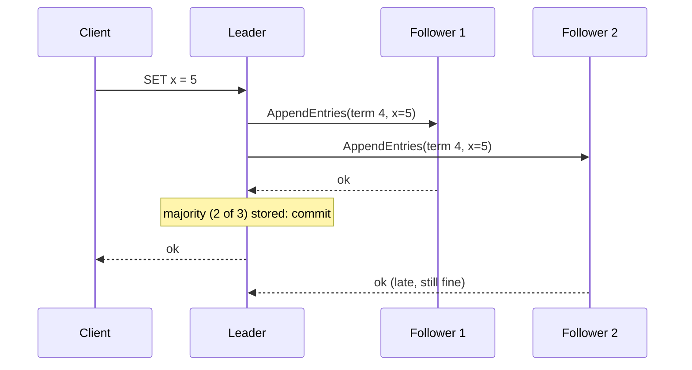

## The problem it solves

Some data must never disagree across replicas: who the current database primary is, which service instances are alive, the configuration of a cluster, the order of transactions. If two nodes each believe they're in charge, or apply writes in a different order, the system corrupts itself.

Consensus algorithms let a group of nodes agree on a single, ordered sequence of values (a **replicated log**), as long as a **majority** of them are up and can talk to each other.

## How it works

Raft, published by Diego Ongaro and John Ousterhout in 2014, was designed to be easier to understand than Paxos while giving the same guarantees. It splits the problem into three parts.

### 1. Leader election

Every node is a **follower**, **candidate** or **leader**. Time is divided into numbered **terms**.

- Followers expect regular heartbeats from the leader. If one hears nothing for a randomized timeout (e.g. 150–300 ms), it becomes a candidate, increments the term and asks the others for votes.
- Each node votes for at most one candidate per term, and only for a candidate whose log is at least as up to date as its own.
- A candidate with votes from a **majority** becomes leader. Randomized timeouts make split votes rare.

### 2. Log replication

- Clients send commands to the leader, which appends them to its log and sends them to followers.
- Once a **majority** have stored an entry, it's **committed**: the leader applies it to its state machine and replies to the client.
- Followers apply committed entries in the same order, so every node's state machine ends up identical.

### 3. Safety

A leader never overwrites or deletes committed entries, and the voting rule ensures any new leader already has every committed entry. A node from an old term that reappears sees a higher term number and steps down.

### Why a majority

With 2f + 1 nodes, Raft tolerates f failures: 3 nodes survive 1 failure, 5 survive 2. Any two majorities overlap in at least one node, so a new leader always overlaps with whoever acknowledged the last committed write.

## Trade-offs

- **Writes need a majority round trip.** Consensus clusters are usually 3 or 5 nodes and placed in nearby zones; spreading them across continents adds latency to every write.
- **The minority side stops.** During a partition, nodes that can't reach a majority refuse writes. That's the consistency side of [CAP](/principles/cap-theorem).
- **Not a database for everything.** Consensus systems like etcd and ZooKeeper store small amounts of critical metadata (leaders, config, locks), not your application data. Databases like CockroachDB and TiDB run many Raft groups, one per data range, to scale.
- **Disk and network health matter.** A slow disk on the leader slows every write; pauses longer than the election timeout cause leader churn.

## In the real world

<Callout type="example" title="Raft everywhere">
Raft is the consensus layer of **etcd** (which stores all Kubernetes cluster state), **HashiCorp Consul** and **Vault**, and databases such as **CockroachDB**, **TiDB** and **YugabyteDB**, which run a Raft group per range of data. GitHub runs its MySQL failover tool, orchestrator, as a Raft cluster so the failover decision-maker itself survives failures.
</Callout>

Before Raft, Google's **Chubby** lock service and **Spanner** used Paxos, and Apache **ZooKeeper** uses a similar protocol called Zab. Roblox's 73-hour outage shows what happens when a consensus-backed service everyone depends on gets slow. See [Roblox's 73-hour outage](/postmortems/roblox-consul-2021).

## Interview angle

<Callout type="interview">
You rarely implement consensus in an interview, but you should know when to use it: "leader election and cluster membership go in etcd/ZooKeeper", "this metadata needs to be linearizable, so it's stored in a Raft group of five nodes across three zones". Mention majority quorums and that the minority side becomes unavailable during partitions.
</Callout>

- Running an even number of consensus nodes (4 tolerates no more failures than 3).
- Putting high-volume application data in etcd or ZooKeeper.
