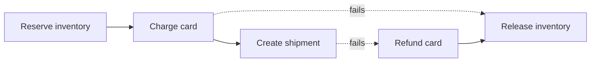

## The problem it solves

Placing an order might mean: reserve inventory in the inventory service, charge the card in the payment service, and create a shipment in the shipping service. Each service has its own database. If payment fails after inventory was reserved, the reservation must be undone. There's no single database transaction that covers all three.

## How it works

### Two-phase commit (2PC)

A coordinator makes several databases commit atomically:

1. **Prepare:** the coordinator asks each participant to prepare. Each one writes the changes durably and locks the data, then votes yes or no.
2. **Commit:** if all vote yes, the coordinator tells everyone to commit; otherwise, to abort.

2PC gives real atomicity, but if the coordinator crashes after participants voted yes, they're stuck holding locks until it recovers ("blocking"). It also needs every participant to support the protocol, and it couples services tightly. It's used inside databases (like Spanner, whose participants are fault-tolerant Paxos groups) more than between microservices.

### Sagas

A saga is a sequence of **local transactions**, each in one service. If a step fails, the saga runs **compensating transactions** for the steps that already completed, in reverse.

Two styles:

- **Orchestration:** a central saga orchestrator tells each service what to do and tracks progress. Easier to understand and monitor; the orchestrator is often built on a workflow engine (Temporal, AWS Step Functions, Uber's Cadence).
- **Choreography:** each service listens for events and publishes its own ("InventoryReserved" → payment service charges → "PaymentSucceeded"...). No central coordinator, but the flow is spread across services and harder to follow.

### Making sagas safe

- Every step and compensation must be **idempotent**, since messages may be redelivered.
- Publish events reliably with the [transactional outbox](/principles/transactional-outbox).
- Some steps can't be undone (an email sent). Put them last, or use semantic compensation (send a correction).
- Sagas give no isolation: other requests may see intermediate states, like reserved stock that later gets released. Design for it with states such as `PENDING`.

## Trade-offs

| | 2PC | Saga |
|---|---|---|
| Atomicity | Yes | Eventually, via compensation |
| Isolation | Yes (locks) | No; intermediate states are visible |
| Availability | Blocks on coordinator failure | Each step independent |
| Coupling | Tight | Loose |
| Complexity | In the protocol | In the business logic (compensations) |

## In the real world

<Callout type="example" title="Workflow engines for sagas">
Uber built **Cadence** to run long-lived, fault-tolerant workflows such as trip and payment flows; its creators later founded Temporal on the same model. A workflow engine persists every step's progress, retries failures and runs compensations, so developers write the saga as ordinary code instead of hand-building state machines over queues.
</Callout>

The term comes from a 1987 database paper by Hector Garcia-Molina and Kenneth Salem, which proposed splitting long-lived transactions into a sequence of smaller ones with compensating actions, so that a long transaction wouldn't hold locks for its whole duration.

## Interview angle

<Callout type="interview">
For a multi-service operation like checkout, draw the saga: the steps, the compensations, and whether it's orchestrated or choreographed. Mention idempotent steps, the outbox for events, and how the UI shows pending states.
</Callout>

- Proposing 2PC across independently owned microservices.
- Forgetting compensations, or steps that can't be compensated.
