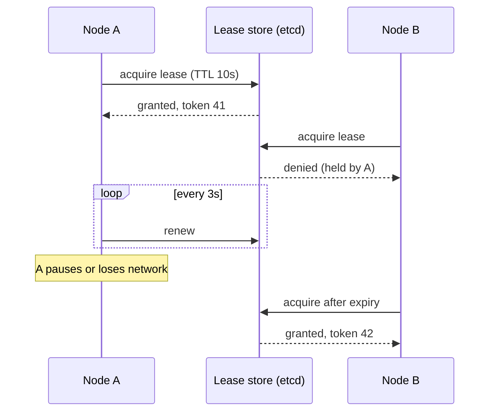

## The problem it solves

Some work is simpler or only correct if one node does it:

- A database primary that orders all writes.
- A scheduler that assigns jobs, so the same job isn't run twice.
- A process that sends a daily billing email.
- A shard owner that serves a range of keys.

Running one instance makes it a single point of failure. Running several without coordination means they step on each other. Leader election runs several candidates, picks **one** to be active, and promotes another when it fails.

## How it works

### Leases from a coordination service

The common approach: use a strongly consistent store (etcd, ZooKeeper, Consul, or a database with conditional writes) to hold a **lease**, a record saying "node A is leader until time T".

1. Each candidate tries to create or take over the lease with an atomic compare-and-set.
2. The winner is leader and must **renew** the lease before it expires.
3. If the leader crashes or is cut off, it stops renewing; when the lease expires, another candidate takes it.

### Built-in election

Consensus protocols like [Raft](/principles/consensus-and-raft) elect a leader as part of the protocol. Databases with automatic failover (Postgres with Patroni, MySQL with orchestrator) elect a new primary using a consensus store or their own quorum logic.

### Choosing timeouts

- **Short leases** fail over quickly but risk needless failovers during GC pauses or network blips.
- **Long leases** are stable but mean longer downtime when the leader really dies.
- Renew well before expiry, for example every third of the lease duration.

## Trade-offs

- **Two leaders can still happen.** A leader that's paused (GC, VM migration) can wake up after its lease expired and act as if it's still in charge. Every action it takes must be checked with a **fencing token**. See [split brain and fencing](/principles/split-brain-and-fencing).
- **Clocks matter.** Lease expiry depends on time; a node with a fast or slow clock may misjudge it. Use monotonic clocks and margins.
- **The leader is a bottleneck.** All work funnels through one node; partition the work (one leader per shard) when it outgrows a single machine.
- **Avoid if you can.** Amazon's Builders' Library suggests that designs which don't need a leader, using idempotent operations or partitioned work, are often simpler and more robust.

## In the real world

<Callout type="example" title="Amazon: leases with care">
The Amazon Builders' Library article on leader election describes how many AWS systems elect leaders with leases backed by a consistent store, such as DynamoDB conditional writes. It stresses that a leader must check it still holds the lease before acting, since even well-designed systems can briefly have two nodes that think they're leader. Work done by the leader should therefore be idempotent or fenced.
</Callout>

Kubernetes controllers and schedulers use the same pattern: multiple replicas run, and a lease object in the API server (backed by etcd) decides which one is active.

## Interview angle

<Callout type="interview">
When your design has a singleton component (a scheduler, a primary, a cron job), say how it's made highly available: "three instances, leader elected through an etcd lease with a 10-second TTL, and every write includes the lease's fencing token". That covers failover and the two-leaders problem.
</Callout>

- Leader election without fencing.
- Relying on wall-clock time across machines for lease expiry.
