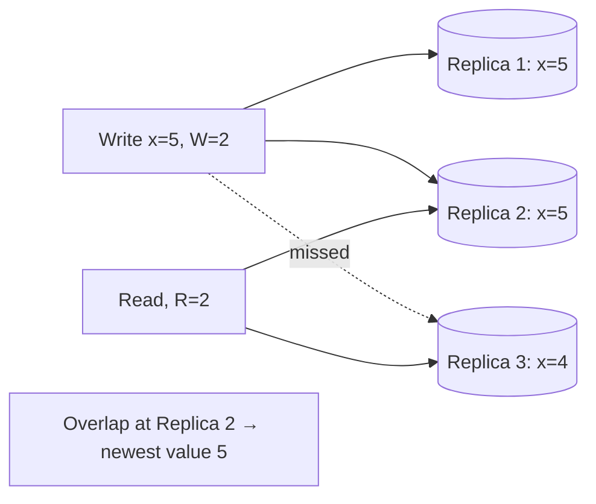

## The problem it solves

In a leaderless replicated store, any replica can accept reads and writes. If a write reaches only some replicas, a later read might hit one that missed it. Waiting for **all** replicas makes every request as slow as the slowest replica and fails if any is down. Waiting for **one** is fast but may return stale data. Quorums sit in between.

## How it works

- **N:** number of replicas for each key (commonly 3).
- **W:** number of replicas that must acknowledge a write.
- **R:** number of replicas a read must hear from.

If **W + R > N**, the set of replicas written and the set read always overlap in at least one replica, so a read includes at least one copy of the latest successful write. The reader picks the newest version among the responses (by version number or vector clock).

| N, W, R | Behaviour |
|---|---|
| 3, 2, 2 | Common balanced choice; tolerates one slow or failed replica for both reads and writes |
| 3, 3, 1 | Fast reads, but writes fail if any replica is down |
| 3, 1, 3 | Fast writes, slow reads |
| 3, 1, 1 | Fastest, but reads may be stale (W + R ≤ N) |

### Keeping replicas in sync

- **Read repair:** when a read sees an older version on some replica, it writes the newer version back.
- **Anti-entropy:** background processes compare replicas (often using Merkle trees, which let them find differences without comparing every key) and fix divergence.
- **Hinted handoff and sloppy quorums:** if a target replica is down, another node accepts the write temporarily and hands it over later. This keeps writes available but weakens the overlap guarantee until the hint is delivered.

## Trade-offs

- **Quorums aren't linearizability.** Concurrent writes, sloppy quorums, partial failures and clock-based conflict resolution can still produce anomalies. For strict guarantees, use [consensus](/principles/consensus-and-raft).
- **Latency follows the Wth or Rth fastest replica.** Larger quorums mean slower requests, especially across zones.
- **Tunable per request.** Cassandra lets each query choose a consistency level (ONE, QUORUM, ALL, LOCAL_QUORUM), so you can pay for consistency only where it matters.
- **Multi-region:** a global quorum adds cross-region latency; `LOCAL_QUORUM` keeps it within a region at the cost of cross-region freshness.

## In the real world

<Callout type="example" title="Dynamo and its descendants">
Amazon's Dynamo paper made (N, R, W) configurable per application. It described a common setting of (3, 2, 2) and used sloppy quorums with hinted handoff so the shopping cart stayed writable during failures. Cassandra and Riak adopted the model; Apple and Netflix are among the largest Cassandra operators.
</Callout>

Amazon DynamoDB, despite the name, works differently: its 2022 paper describes each partition as a replication group using **Multi-Paxos** with an elected leader. Writes are acknowledged once a quorum of replicas has persisted them, and strongly consistent reads go to the leader.

## Interview angle

<Callout type="interview">
When you replicate data three ways in a leaderless store, state your quorum: "N=3, W=2, R=2, so reads see the latest write while tolerating one replica failure", and say which queries can use R=1 for speed.
</Callout>

- Claiming quorums give linearizability.
- Forgetting how replicas converge (read repair, anti-entropy).
