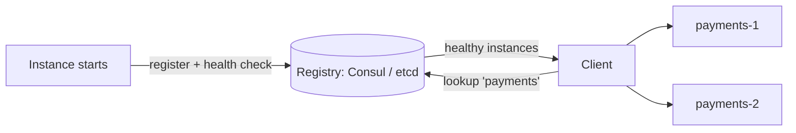

## The problem it solves

With autoscaling, deploys and failures, the set of machines running a service changes all the time, and each instance gets a different IP address. Hardcoding addresses in config breaks within minutes. Callers need a way to ask "where is the payments service right now?" and get healthy instances back.

## How it works

### A registry of instances

1. **Registration:** when an instance starts, it registers itself (or the platform registers it) with its address and metadata.
2. **Health checking:** the registry checks instances or listens for heartbeats, removing unhealthy ones. See [failure detection](/principles/failure-detection-and-heartbeats).
3. **Lookup:** clients query the registry by service name.

The registry itself must be highly available and consistent, so it's usually built on [consensus](/principles/consensus-and-raft): Consul and etcd use Raft, ZooKeeper uses Zab.

### Client-side vs server-side discovery

- **Client-side:** the client fetches the list of instances and load-balances itself. One less hop, but every client needs discovery logic. (Netflix's Eureka with client libraries worked this way.)
- **Server-side:** the client calls a stable address, a load balancer or proxy, which looks up instances. Clients stay simple.

### Common implementations

| Approach | How clients find instances |
|---|---|
| **DNS** | Name resolves to current IPs. Universal, but caching and TTLs delay updates |
| **Consul / etcd / ZooKeeper** | Query a registry API or DNS interface; watch for changes |
| **Kubernetes Services** | A stable virtual IP and DNS name per service; the platform routes to healthy pods |
| **Service mesh** (Istio, Linkerd) | A sidecar proxy beside each instance handles discovery, load balancing, retries and mTLS |

## Trade-offs

- **The registry is critical infrastructure.** If it fails, new connections can't find services. Clients should **cache the last known list** and keep using it if the registry is unavailable (a form of [static stability](/principles/static-stability)).
- **Stale entries:** caching and slow health checks route traffic to dead instances for a while; clients need timeouts and retries against other instances.
- **DNS caching:** some clients ignore TTLs and cache for a long time, delaying failover.
- **Shared fate:** using one registry cluster for everything makes it a single point of failure; split by workload or region.

## In the real world

<Callout type="example" title="Roblox: when discovery goes down">
Roblox used a single large HashiCorp Consul cluster for service discovery, health checks, locks and key-value config. When it became slow and unstable in October 2021, almost every service failed with it, and the platform was down for 73 hours. Roblox later split Consul into multiple clusters and removed critical dependencies on it. See [Roblox's 73-hour outage](/postmortems/roblox-consul-2021).
</Callout>

Kubernetes made service discovery largely invisible: a Service gives a set of pods a stable DNS name and virtual IP, and the platform keeps the endpoints updated as pods come and go, so most application code simply calls `http://payments`.

## Interview angle

<Callout type="interview">
In a microservice design, mention how services find each other ("Kubernetes Services" or "Consul with client-side caching"), and what happens if the registry is unavailable: clients keep using their cached instance list.
</Callout>

- Hardcoded IPs or hostnames in config.
- No fallback when the registry is down.
