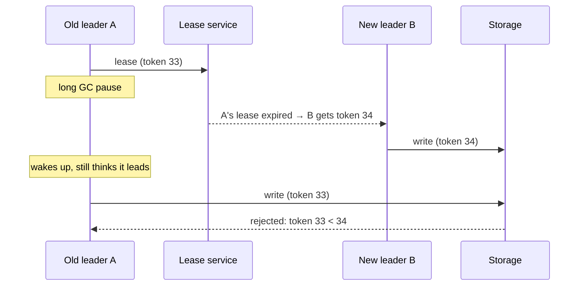

## The problem it solves

Leader election decides a new leader when the old one seems dead. But "seems dead" might mean paused for 30 seconds of garbage collection, or cut off by a network partition while still running. When the old leader comes back, it may still think it's in charge.

Now two nodes accept writes. Their data diverges, and reconciling it later can be painful or impossible. This is **split brain**.

## How it works

### Fencing tokens

Every time the lock service grants leadership, it hands out a **monotonically increasing token**. The leader includes the token in every write. The storage system remembers the highest token it has seen and **rejects writes with a lower token**.

The key insight, from Martin Kleppmann's analysis of distributed locks: a lease alone isn't enough, because the leader can't reliably know its lease has expired (it might be paused at any moment, even between checking and writing). The **resource being protected** must do the check.

### Other fencing techniques

- **STONITH** ("shoot the other node in the head"): before promoting a new leader, forcibly power off or isolate the old one through out-of-band management.
- **Revoke access at the routing layer:** cut network or proxy access to the old leader, as GitHub does with HAProxy when orchestrator fails over a MySQL primary.
- **Quorum-based writes:** a leader that can't reach a majority can't commit anything, which is how [Raft](/principles/consensus-and-raft) avoids split brain by design.

### Prevent it in the first place

- Require a **majority** to elect a leader, so two sides of a partition can't both win.
- Have leaders **step down** when they can't renew their lease or reach a quorum.
- Avoid failover on very short blips; brief partitions are where split brain is most likely.

## Trade-offs

- **Fencing needs storage cooperation.** If the downstream system can't check tokens, you need other mechanisms like STONITH or access revocation.
- **Aggressive failover increases risk.** Faster detection means more false positives, and more chances for two leaders.
- **Majority requirements reduce availability.** The minority side of a partition can't elect a leader, and stops accepting writes.

## In the real world

<Callout type="example" title="GitHub's 43-second partition">
In October 2018, a 43-second network partition caused GitHub's MySQL failover tool to promote primaries on the US West Coast while the East Coast primaries had already accepted writes that hadn't replicated. When connectivity returned, both sides held writes the other lacked, and GitHub spent about 24 hours restoring consistency. See [GitHub's 43-second partition](/postmortems/github-network-partition-2018).
</Callout>

Kleppmann's 2016 critique of Redlock, a Redis-based distributed locking algorithm, popularized fencing tokens. It argued that any lock used for correctness must be paired with a token that the protected resource checks, since process pauses and clock jumps can always make a lock holder outlive its lock.

## Interview angle

<Callout type="interview">
After describing leader election or failover, add: "The old leader is fenced: every write carries the lease's fencing token and the database rejects stale tokens" or "the proxy cuts the old primary off before promoting the new one". Interviewers look for awareness that leases alone don't prevent two leaders.
</Callout>

- Assuming a lease guarantees only one leader.
- Fast automatic failover with no fencing.
