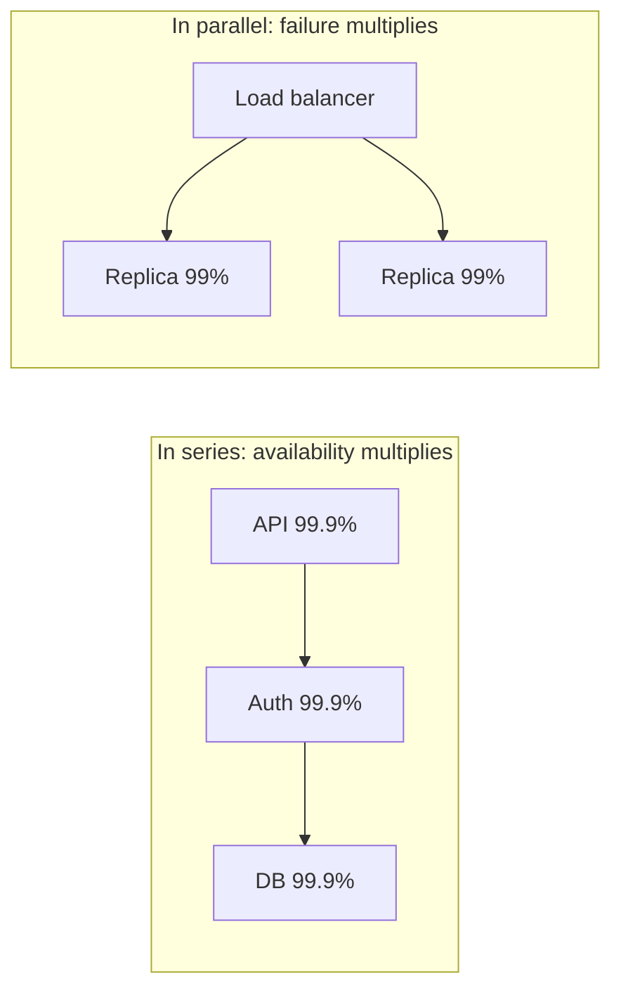

## The problem it solves

"Highly available" means nothing until you put a number on it. The number decides how much redundancy you build, how fast on-call has to respond, and how much it all costs.

## How it works

Availability = successful time (or requests) ÷ total. It's usually expressed in "nines":

| Availability | Downtime per year | Downtime per 30 days |
|---|---|---|
| 99% (two nines) | ~3.65 days | ~7.2 hours |
| 99.9% (three nines) | ~8.8 hours | ~43 minutes |
| 99.95% | ~4.4 hours | ~22 minutes |
| 99.99% (four nines) | ~53 minutes | ~4.3 minutes |
| 99.999% (five nines) | ~5.3 minutes | ~26 seconds |

At four nines, a single incident that takes 10 minutes to notice and fix uses up two months of budget. Five nines is effectively impossible to achieve with humans in the response loop; it requires automatic failover.

### Dependencies multiply

If a request **needs** services A, B and C, and each is 99.9% available, the best you can get is:

```text
0.999 × 0.999 × 0.999 ≈ 99.7%
```

Each hard dependency you add lowers your ceiling.

### Redundancy adds

If you run two independent copies and need only one, you fail only when both fail:

```text
1 − (0.01 × 0.01) = 99.99%   (two copies at 99% each)
```

This only works if the failures really are **independent**. Two replicas in the same rack, on the same deploy, or behind the same config push fail together.



## Trade-offs

- **Each nine costs much more than the last.** Going from 99.9% to 99.99% usually means multi-zone or multi-region deployment, automated failover and far more testing.
- **Users can't tell the difference past a point.** If a user's phone network or ISP is 99% reliable, your extra nine is mostly invisible. Google's SRE book argues for picking a target that matches what users notice, not 100%.
- **Measure what users experience.** Count failed requests, not whether a process is running. A server can be up while returning errors.

## In the real world

<Callout type="example" title="Google: 100% is the wrong target">
Google's SRE book says that 100% is almost never the right reliability target: users can't tell the difference between 99.999% and 100%, and chasing the last fraction slows down feature work for no benefit. Instead each service picks a target, and the gap between that target and 100% becomes a budget for risk. See [SLIs, SLOs and error budgets](/principles/slis-slos-and-error-budgets).
</Callout>

Google SRE's paper *The Calculus of Service Availability* (ACM Queue, 2017) adds a practical rule: a service's critical dependencies should be roughly **one nine more available** than the service itself, or the service needs to tolerate their failure through caching, fallbacks or [graceful degradation](/principles/graceful-degradation).

## Interview angle

<Callout type="interview">
Ask what availability the product needs, then let it drive the design: "99.9% allows 43 minutes a month, so a single region with multi-zone replicas and automated failover is enough. 99.99% would push us to multi-region." Point out hard dependencies and how you'd soften them.
</Callout>

- Claiming five nines without automated failover.
- Treating replicas that share a failure domain as independent.
