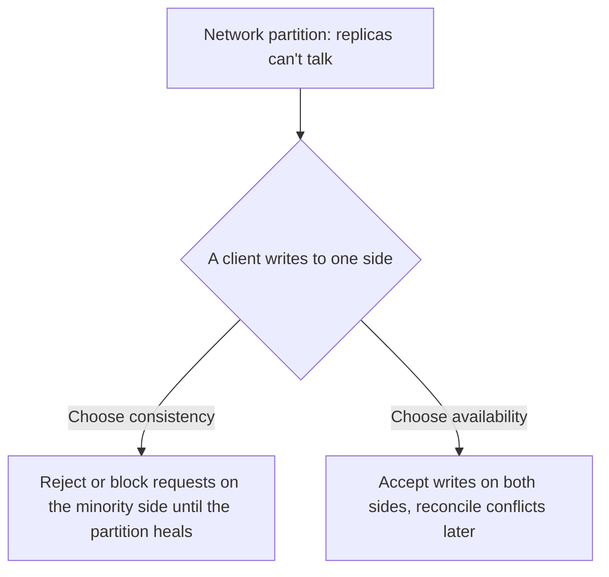

## The problem it solves

Once data is copied to more than one machine, those machines have to talk over a network, and networks fail. Links drop, switches misbehave, and a whole datacenter can lose contact with another. The CAP theorem says what's possible when that happens, which forces you to decide in advance how your system behaves.

## How it works

Eric Brewer stated the conjecture in 2000, and Seth Gilbert and Nancy Lynch proved it in 2002. It concerns three properties:

- **Consistency (C):** every read sees the most recent write, as if there were one copy of the data. Formally, this is *linearizability*.
- **Availability (A):** every request to a non-failed node gets a non-error response.
- **Partition tolerance (P):** the system keeps working even if messages between nodes are lost.

The theorem: **during a network partition, you can't have both C and A.**

Since you can't prevent partitions in a real network, "pick two of three" is misleading. The real choice is what to do *when a partition happens*:

- **Consistency-first (CP)** systems, such as ZooKeeper, etcd and single-leader databases with synchronous failover, refuse writes on the side that can't reach a majority.
- **Availability-first (AP)** systems, such as Dynamo-style stores and DNS, keep accepting reads and writes on both sides and repair divergence afterwards with techniques like version vectors, last-write-wins or CRDTs.

## Trade-offs

- **Partitions are rare, but not hypothetical.** CAP says nothing about the 99.9% of the time when the network works. That's where the [PACELC](/principles/pacelc) extension helps: even without partitions you trade latency for consistency.
- **The labels are blunt.** Most real systems are neither purely CP nor AP. Many offer per-request choices (for example, quorum reads vs. single-replica reads in Cassandra), and plenty of systems provide neither full linearizability nor full availability.
- **Availability-first means designing for conflicts.** Two people editing the same cart on both sides of a partition will create conflicting versions. Your application must define how to merge them.

## In the real world

<Callout type="example" title="Amazon Dynamo: the shopping cart stays writable">
Amazon's 2007 Dynamo paper chose availability: customers must always be able to add items to their cart, even during failures. Dynamo accepts writes on any reachable replicas and tracks versions with vector clocks. If a partition creates divergent carts, the versions are merged, so a deleted item can occasionally reappear. Amazon judged that a better outcome than refusing the customer's click.
</Callout>

In *CAP Twelve Years Later*, Brewer himself argues that the "two of three" framing was always misleading. Designers should aim to keep both consistency and availability most of the time, and when a partition occurs, detect it, enter an explicit partition mode that limits some operations, and run a recovery process afterwards.

## Interview angle

<Callout type="interview">
Don't just say "this is an AP system". Explain what happens during a partition for the specific operation: "Likes can go to either region and be merged later, but the payment ledger uses a single leader per account, so the minority side rejects writes." Choosing per operation is a strong signal.
</Callout>

- Saying you'll "choose CA" for a distributed system.
- Treating CAP consistency (linearizability) as the same as the C in ACID.
- Ignoring the latency cost of consistency when there's no partition.
