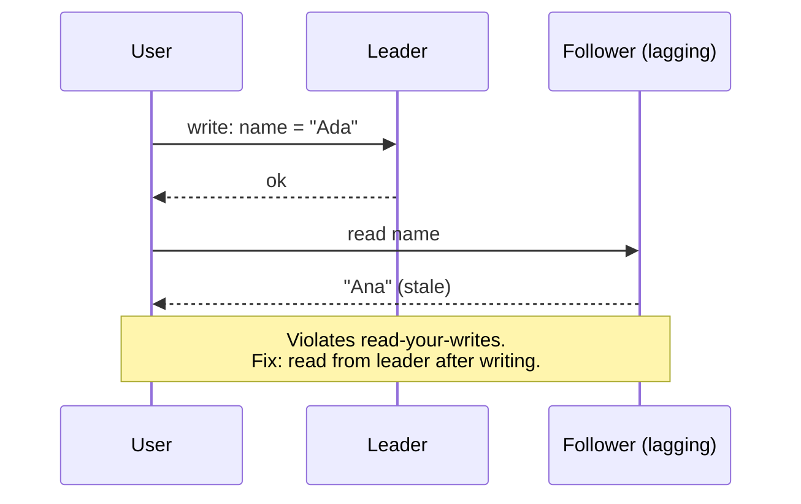

## The problem it solves

With replicas, a write lands on one copy before the others. A read in between can return the old value or the new one. Without a clear rule for which, application developers guess, and the bugs that follow ("I posted a comment and it disappeared", "my order shows as unpaid after I paid") are hard to reproduce.

A consistency model is that rule.

## How it works

From strongest to weakest, the models you'll meet most often:

| Model | Guarantee | Feels like |
|---|---|---|
| **Linearizable** (strong) | Every operation appears to happen at a single instant between its start and end, in real-time order | One copy of the data |
| **Sequential** | All clients see operations in the same order, but not necessarily in real-time order | One copy, slightly delayed |
| **Causal** | If A could have influenced B, everyone sees A before B; unrelated writes may appear in any order | Replies never appear before the message they reply to |
| **Read-your-writes** | A client always sees its own earlier writes | Your edits stick, even if others don't see them yet |
| **Monotonic reads** | A client never sees data go backwards in time | No "flickering" between new and old values |
| **Eventual** | If writes stop, all replicas eventually return the same value | Changes show up, sooner or later |

Read-your-writes and monotonic reads are **session guarantees**. They're cheap to provide and fix most user-visible weirdness, even on top of an eventually consistent store.

### How systems provide them

- **Linearizable:** route all reads and writes for a key through a single leader, or use consensus ([Raft](/principles/consensus-and-raft), Paxos), or majority quorums with care.
- **Read-your-writes:** read from the leader for a short time after the user writes, or pin the user's session to one replica, or have the client send the version it last wrote and wait for a replica that has it.
- **Monotonic reads:** keep each user on the same replica.
- **Causal:** track dependencies with version vectors or hybrid logical clocks.

## Trade-offs

- **Stronger models cost latency and availability.** Linearizability needs coordination, which means extra round trips and unavailability on the minority side of a partition. See [CAP](/principles/cap-theorem) and [PACELC](/principles/pacelc).
- **Weaker models push complexity into the application.** With eventual consistency, code has to handle stale reads, duplicates and conflicting updates.
- **"Eventual" has no deadline.** Measure replication lag; "eventually" might be 50 ms or 5 minutes during an incident.

## In the real world

<Callout type="example" title="Amazon S3: from eventual to strong consistency">
For its first 14 years, S3 offered only eventual consistency for overwrites and deletes, so a read right after an overwrite could return the old object. Big-data tools built workarounds, such as separate consistency layers, to cope. In December 2020, AWS made all S3 GET, PUT and LIST operations **strongly consistent** at no extra cost or latency. Werner Vogels's write-up describes how: S3's metadata cache gained a cache-coherence protocol, with a new component called a *witness* that tracks the latest change to each object so a read can tell whether its cached copy is stale.
</Callout>

Jepsen's analyses have repeatedly found databases that claimed stronger consistency than they delivered under partitions and clock skew. The lesson: test the guarantees you depend on, don't just read the marketing page.

## Interview angle

<Callout type="interview">
Name the model each part of your design needs. "Feed reads can be eventually consistent, but after a user posts we'll read their own posts from the leader for a few seconds to give read-your-writes." Session guarantees are a cheap, sensible answer to most "what if the replica is behind?" questions.
</Callout>

- Using "consistent" without saying which model.
- Assuming eventual consistency converges quickly under load.
