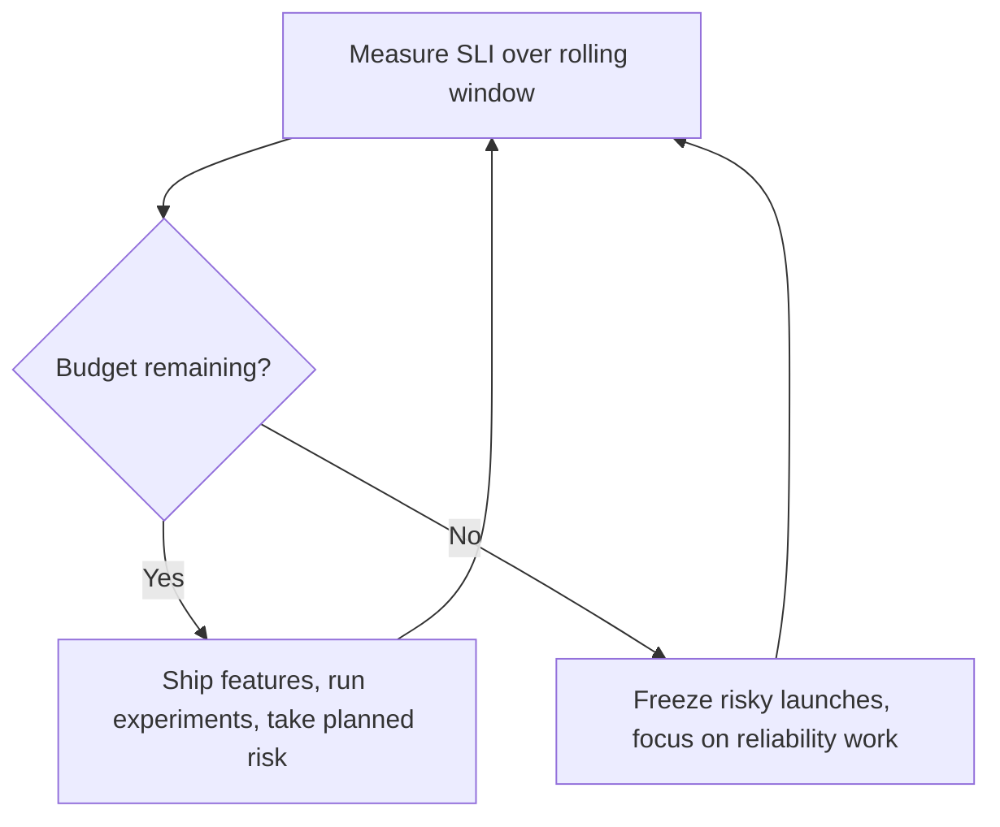

## The problem it solves

Product teams want to ship features quickly. Operations teams want stability. Without a shared, measurable definition of "reliable enough", that argument is settled by whoever is loudest, or by the last outage.

SLOs replace the argument with a number both sides agree on.

## How it works

| Term | Meaning | Example |
|---|---|---|
| **SLI** (indicator) | A measurement of user experience | Fraction of HTTP requests that return non-5xx in under 300 ms |
| **SLO** (objective) | The target for that SLI over a window | 99.9% of requests over 28 days |
| **SLA** (agreement) | A contract with consequences, usually looser than the SLO | 99.5%, or customers get service credits |
| **Error budget** | 100% − SLO | 0.1% of requests may fail: ~40,000 out of 40 million |

### Choosing good SLIs

Good SLIs are **ratios of good events to total events**, measured as close to the user as possible:

- **Availability:** successful requests ÷ valid requests.
- **Latency:** requests faster than a threshold ÷ all requests. This is better than "p99 latency" because it can be summed over time.
- **Freshness** for pipelines: data updated within N minutes ÷ all data.
- **Correctness:** responses with the right answer ÷ all responses.

Measure at the load balancer or client where you can. A server's own metrics miss requests that never reached it.

### The error budget as a decision tool

When the budget is healthy, the team can deploy more often, run risky migrations and do chaos experiments. When it's spent, the agreed policy kicks in: slow down launches and fix what's burning budget. The policy is agreed **in advance**, so nobody argues about it mid-incident.

### Alert on burn rate, not on every error

Paging someone for each failed request causes alert fatigue. Instead alert when the budget is being consumed too quickly. The SRE workbook's suggested starting point: page if the last hour burned 2% of a 30-day budget (a burn rate of about 14×) or the last 6 hours burned 5%, and open a ticket if the last 3 days burned 10%.

## Trade-offs

- **Too strict an SLO** freezes development and burns out on-call for a difference users don't notice.
- **Too loose an SLO** lets users suffer while dashboards stay green.
- **Too many SLOs** dilute attention. Most services need two or three: availability, latency, and possibly freshness.
- **Averages lie.** A latency SLO based on the mean will hide the slow tail. Use thresholds or percentiles.

## In the real world

<Callout type="example" title="Google: error budgets end the dev vs. ops argument">
Google's SRE book describes error budgets as the mechanism that aligns product development and SRE. As long as a service is within its SLO, product teams can push changes as fast as they like. When the budget runs out, releases pause until reliability is restored. Both teams want to avoid burning the budget, so both care about reliability without anyone acting as a gatekeeper.
</Callout>

The SRE workbook adds that SLOs should be revisited: start with what you can measure today, compare it with user complaints and business data, and tighten or relax the target as you learn.

## Interview angle

<Callout type="interview">
When asked about reliability, define one or two SLIs precisely ("successful requests under 300 ms, measured at the load balancer") and an SLO with a window. Then explain how you'd alert (burn rate) and what happens when the budget runs out. This shows you think about reliability as an engineering tradeoff, not a slogan.
</Callout>

- Setting the SLO to 100%.
- Using CPU or memory as an SLI. Users don't experience CPU.
- Writing an SLA tighter than your internal SLO.
