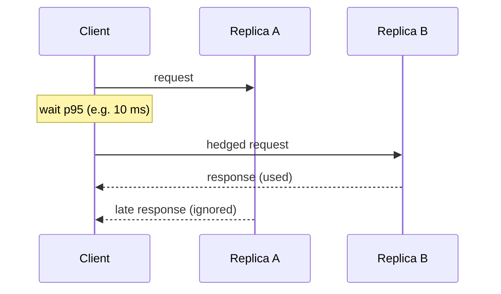

## The problem it solves

Most requests to a server are fast. A few are slow because of a garbage-collection pause, a background compaction, a noisy neighbour on the same host or a cold cache. On its own, a slow 1% sounds tolerable.

But a page load or search query rarely touches just one server. It fans out to tens or hundreds of backends and has to wait for all of them. **The more servers a request touches, the more likely it hits at least one slow one.**

## How it works

### The fan-out math

If each server is slow for 1% of requests, then the chance a request touching *n* servers sees at least one slow response is `1 − 0.99ⁿ`:

| Servers per request | Requests that hit a slow server |
|---|---|
| 1 | 1% |
| 10 | ~10% |
| 100 | ~63% |

At 100-way fan-out, the per-server p99 becomes the user's **median**. This is why large systems care about p99 and p99.9, not averages.

### Techniques that reduce the tail

- **Hedged requests.** Send the request to one replica. If no answer arrives within, say, the p95 latency, send the same request to a second replica and use whichever answers first. The extra load is small because only a few requests get hedged.
- **Tied requests.** Send to two replicas at once, each told about the other. Whichever starts processing first tells the other to cancel.
- **Timeouts and partial results.** For search or feeds, return results from the backends that answered in time rather than waiting for the last one.
- **Remove sources of variability.** Limit background work (compaction, GC) during peak, isolate noisy tenants, avoid queueing at high utilization.
- **Micro-partitioning.** Split data into many more partitions than machines, so a slow or hot machine can shed a few partitions quickly.

## Trade-offs

- **Hedging adds load.** If you hedge too early or too often, you double traffic exactly when the system is struggling. Hedge only after a delay, and cap the hedge rate.
- **Only for idempotent reads.** Duplicating a write like "charge the card" is dangerous unless the operation is [idempotent](/principles/idempotency).
- **Partial results change semantics.** Fine for search ranking, not for a bank balance.

## In the real world

<Callout type="example" title="Google: hedged requests in BigTable">
In *The Tail at Scale*, Jeff Dean and Luiz André Barroso describe a BigTable benchmark that read 1,000 keys spread across 100 servers. Sending a hedged request after a 10 ms delay cut the **99.9th-percentile latency from 1,800 ms to 74 ms** while sending only about 2% more requests.
</Callout>

Discord's move from Cassandra to ScyllaDB was driven largely by tail latency from JVM garbage-collection pauses, not by average query cost. See [How Discord stores trillions of messages](/case-studies/discord-trillions-of-messages).

## Interview angle

<Callout type="interview">
If your design fans out (a feed that queries many shards, a search over an index split across machines), say so and mention tail latency. Offer one mitigation such as hedged reads, per-shard timeouts with partial results, or keeping fan-out small. It shows you understand why large systems behave differently from small ones.
</Callout>

- Quoting only average latency.
- Hedging writes that aren't idempotent.
- Retrying immediately without a delay or budget, which amplifies load.
