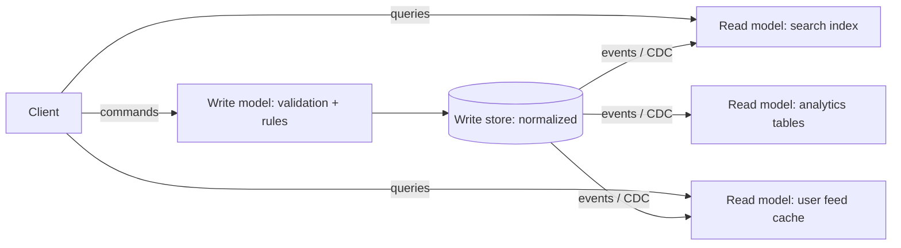

## The problem it solves

One data model rarely suits both writing and reading well. Writes need validation, invariants and normalized data to stay correct. Reads want denormalized, pre-joined data in whatever shape each screen needs: a search box wants a full-text index, a dashboard wants aggregates, a feed wants a per-user list.

Forcing both through one schema leads to slow, complicated queries or a write model cluttered with read concerns.

## How it works

- **Commands** (writes) go to the **write model**, which enforces business rules and stores the authoritative data.
- Each change produces an event or change record.
- **Read models** subscribe to those changes and maintain their own stores, each optimized for a specific query.
- **Queries** go only to read models.

You can apply CQRS at different strengths:

1. **Same database, separate code paths** for commands and queries.
2. **Read replicas or materialized views** in the same database engine.
3. **Separate stores** per read model (search index, cache, warehouse), updated asynchronously.

## Trade-offs

- **Each side scales independently.** Read-heavy systems can add read stores without touching the write path.
- **Queries become simple lookups** against data already in the right shape.
- **Eventual consistency:** read models lag behind writes, sometimes noticeably. Handle read-your-writes in the UI (show the user's change optimistically, or read it from the write model briefly).
- **More moving parts:** pipelines to maintain, read models to rebuild when they drift, and more code overall.
- **Don't use it everywhere.** Martin Fowler warns that CQRS adds risky complexity and suits only specific parts of a system with clearly different read and write needs.

## In the real world

<Callout type="example" title="Feeds are CQRS">
Twitter's home timeline is a read model: tweets are written once to the source of truth, and a fan-out process updates a per-user timeline cache shaped exactly for the "show my feed" query. See [How Twitter built home timelines](/case-studies/twitter-timelines).
</Callout>

Many e-commerce systems follow the same pattern without calling it CQRS: orders are written to a transactional database, while product search runs against Elasticsearch and reporting runs against a warehouse, both fed by change streams from the main database.

## Interview angle

<Callout type="interview">
When reads and writes have very different shapes or scale, separate them: "orders are written to Postgres; a CDC stream feeds a search index and a per-user order history cache". Then explain how you handle lag, for example by showing the user's own change immediately.
</Callout>

- Applying CQRS to a simple CRUD service.
- Forgetting how to rebuild a read model that gets out of sync.
