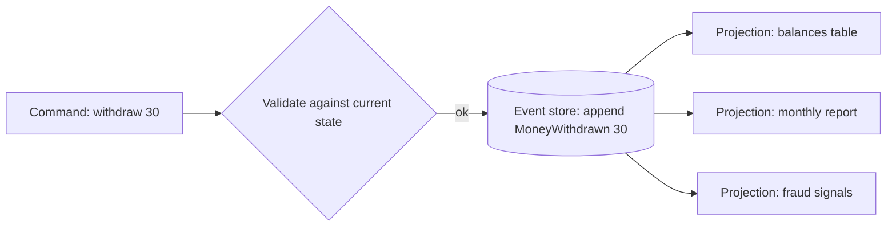

## The problem it solves

A typical database row holds only the latest state: `balance = 120`. You can't tell how it got there, what it was last Tuesday, or whether a bug corrupted it along the way. Adding a new view of the data (say, monthly spending by category) means it can only start from today.

Event sourcing keeps the history as the source of truth.

## How it works

1. Every change is recorded as an **event**, an immutable fact in the past tense: `AccountOpened`, `MoneyDeposited(50)`, `MoneyWithdrawn(30)`.
2. Events for an entity are appended to its **stream**, in order, and never updated or deleted.
3. Current state is computed by **replaying** the events (a fold): start empty and apply each event.
4. **Projections** (read models) consume the events to build query-friendly views, such as a balance table or a search index.
5. **Snapshots** of state every N events keep replays fast.

### Your bank account already works this way

A ledger is a list of transactions; the balance is derived. Accounting has worked like this for centuries because history matters and mistakes are corrected with new entries, not erasure.

### Writes and concurrency

To avoid two commands acting on stale state, appends use **optimistic concurrency**: "append this event only if the stream is still at version 17". If someone else appended first, reload and retry.

## Trade-offs

- **Complete audit trail** and the ability to answer "what was the state at time T?"
- **New views from old data:** build a new projection by replaying history.
- **Debugging:** replay events to reproduce a bug exactly.
- **But schema changes are hard:** old events live forever, so code must handle every version of every event type (or upcast them).
- **Eventual consistency between write and read models:** projections lag behind the event store.
- **Deleting data** (e.g. for privacy laws) conflicts with immutability; techniques include encrypting personal data per user and deleting the key.
- **Overkill for simple CRUD.** Use it where history, audit or complex domain logic justify it.

## In the real world

<Callout type="example" title="The log as the source of truth">
Jay Kreps's essay on the log, which shaped Kafka, argues that a log of all changes is a complete representation of a dataset: tables, caches and indexes are just projections that can be rebuilt by replaying it. Change data capture applies this to existing databases, streaming every committed change into Kafka so downstream systems can build their own views.
</Callout>

Event sourcing is common in finance, accounting, logistics and other domains where an audit trail is required, and it often pairs with [CQRS](/principles/cqrs), using the event stream to keep separate read models up to date.

## Interview angle

<Callout type="interview">
Suggest event sourcing when the problem needs history or audit (a ledger, order lifecycle, compliance). Describe events as immutable facts, projections for reads, snapshots for speed, and acknowledge the cost: eventual consistency and event schema evolution.
</Callout>

- Using event sourcing for a simple CRUD app.
- Storing commands ("WithdrawMoney") instead of facts ("MoneyWithdrawn").
