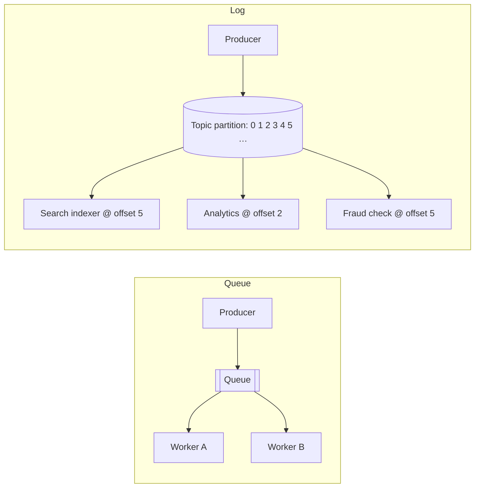

## The problem it solves

When service A calls service B synchronously, A waits for B, fails when B is down, and is slowed when B is slow. Many tasks, like sending email, resizing images or updating a search index, don't need to happen inside the user's request.

Putting a message broker between them **decouples in time**: A writes a message and moves on; B processes it when it can. Spikes are absorbed by the backlog instead of overloading B.

## How it works

### Message queues

Examples: Amazon SQS, RabbitMQ, ActiveMQ, Google Cloud Tasks.

- Producers send messages to a queue; **each message goes to one consumer** in a pool of workers.
- The consumer **acknowledges** after processing, and the message is deleted. If no ack arrives within a visibility timeout, the message is redelivered.
- Messages that keep failing are moved to a **dead-letter queue** for inspection.
- Ordering is usually best-effort (FIFO queues exist, with lower throughput).

Best for: **work distribution**. Jobs, tasks and commands where each should be done once by someone.

### Logs (streams)

Examples: Apache Kafka, Amazon Kinesis, Apache Pulsar, Redpanda.

- Producers append records to a **topic**, split into **partitions**. Records are ordered within a partition.
- Records **stay** for a retention period (days, or forever with compaction). Reading doesn't delete them.
- Each **consumer group** tracks its own position (offset). Many independent consumers read the same data.
- Consumers can **rewind and replay**, for example to rebuild a database or fix a bug.

Best for: **event streams**. Facts that many systems care about, analytics, change data capture, stream processing.

## Trade-offs

| | Queue | Log |
|---|---|---|
| Delivery | Each message to one consumer | Every consumer group gets every record |
| After processing | Deleted | Retained; replayable |
| Ordering | Weak (or FIFO with limits) | Strong within a partition |
| Scaling consumers | Add workers freely | Parallelism capped by number of partitions |
| Per-message retries | Built in (visibility timeout, DLQ) | Manual; a stuck record blocks its partition |
| Typical use | Background jobs | Event streaming, data integration |

Both are **at-least-once** in practice, so consumers must be [idempotent](/principles/idempotency).

## In the real world

<Callout type="example" title="LinkedIn builds Kafka">
LinkedIn created Kafka because its point-to-point data pipelines between dozens of systems had become unmanageable. A shared, replayable log turned many custom integrations into one pattern: write to the log, read from the log. See [LinkedIn, Kafka and the log](/case-studies/linkedin-kafka-and-the-log).
</Callout>

Many systems use both: Kafka for the stream of business events (`OrderPlaced`), and a task queue for the jobs those events trigger (send this email, generate this invoice), where per-job retries and dead-letter handling matter more than replay.

## Interview angle

<Callout type="interview">
When you add async processing, say which kind and why: "a queue for thumbnail jobs, since each needs to be done once with retries", or "a Kafka topic for order events, since search, analytics and notifications all consume them independently". Mention idempotent consumers and the dead-letter queue.
</Callout>

- Using a queue when several systems need the same events.
- Choosing too few partitions to scale consumers later.
- Forgetting poison messages that fail forever.
