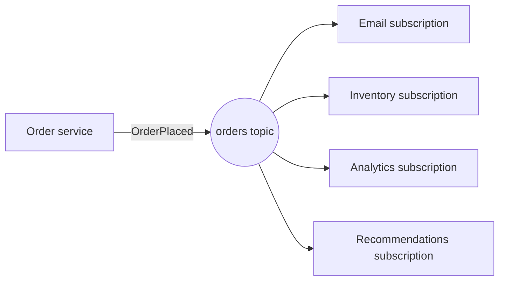

## The problem it solves

When an order is placed, many things should happen: send a confirmation email, update inventory, notify the warehouse, record analytics, update recommendations. If the order service calls each of them directly, it has to know about every one, wait for them, and change every time a new team wants to react to orders.

Pub/sub inverts this: the order service announces "an order was placed" once, and anyone interested listens.

## How it works

- **Publishers** send messages to a named **topic**.
- **Subscribers** register interest in a topic; each subscription receives **its own copy** of every message.
- Within a subscription, messages are spread across that subscriber's workers like a queue.

### Flavours

| Kind | Examples | Durability | Typical use |
|---|---|---|---|
| Managed cloud pub/sub | Google Cloud Pub/Sub, Amazon SNS + SQS, Azure Service Bus topics | Durable, at-least-once | Service-to-service events |
| Log-based | Kafka, Kinesis, Pulsar | Durable, replayable | Event streams, analytics |
| In-memory | Redis Pub/Sub, NATS core | Fire-and-forget; offline subscribers miss messages | Cache invalidation, presence, live updates |

### Fan-out to users

Pub/sub also powers real-time features: chat messages, notifications and live dashboards. Servers holding users' WebSocket connections subscribe to channels for those users and push messages as they arrive.

## Trade-offs

- **Loose coupling hides dependencies.** It's easy to lose track of who consumes an event; changing its shape can break unknown subscribers. Use a schema registry or versioned event contracts.
- **No reply.** The publisher doesn't know whether subscribers succeeded. Use separate events or a saga if outcomes matter.
- **Ordering and duplicates.** Most systems are at-least-once and order only within a key or partition; subscribers must be idempotent.
- **In-memory pub/sub drops messages** for disconnected subscribers. Fine for "refresh this cache entry", wrong for "charge this customer".

## In the real world

<Callout type="example" title="Cache invalidation by broadcast">
Stack Overflow's architecture uses Redis pub/sub to tell every web server to drop an entry from its local in-memory cache when data changes. Losing an occasional message only means a short-lived stale entry, an acceptable trade-off for a cheap, fast broadcast. See [multi-tier caching](/principles/multi-tier-caching).
</Callout>

Google Cloud Pub/Sub and the Amazon SNS-plus-SQS pattern are the standard building blocks for service-to-service events in the cloud: SNS fans each message out to one SQS queue per consuming service, so each service processes events at its own pace with its own retries.

## Interview angle

<Callout type="interview">
When one action triggers several independent reactions, publish an event to a topic and let each service subscribe. Mention at-least-once delivery, idempotent subscribers, and that the event schema is a contract.
</Callout>

- Using fire-and-forget pub/sub for events that must not be lost.
- Publishing events before the database transaction commits (see the [outbox pattern](/principles/transactional-outbox)).
