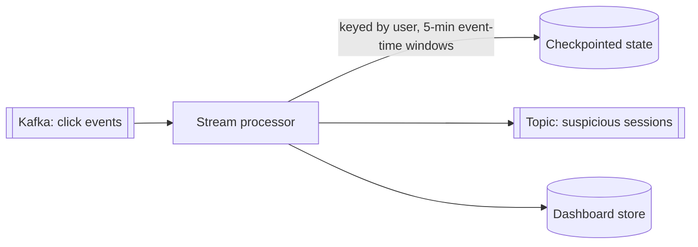

## The problem it solves

Fraud detection, surge pricing, live dashboards and recommendation features need answers within seconds of events happening, not after tonight's batch job. Data also never really "ends": clicks, payments and sensor readings keep arriving.

Stream processing treats data as an **unbounded stream** and keeps results continuously up to date.

## How it works

A stream processor (Apache Flink, Kafka Streams, Spark Structured Streaming, Google Cloud Dataflow) reads from a log like Kafka, transforms or aggregates events, and writes results to another topic, a database or a cache.

### Stateless and stateful operations

- **Stateless:** filter, map, enrich each event independently.
- **Stateful:** counts, sums, joins and pattern detection that remember earlier events. State lives in the processor (often in an embedded store like RocksDB) and is **checkpointed** so it survives crashes.

### Windows

Aggregations over infinite streams need boundaries:

| Window | Example |
|---|---|
| **Tumbling** | Orders per minute, non-overlapping |
| **Sliding / hopping** | Average latency over the last 5 minutes, updated every 30 seconds |
| **Session** | A user's activity until 30 minutes of inactivity |

### Event time vs processing time

- **Processing time:** when the processor sees the event.
- **Event time:** when the event actually happened.

A phone that was offline for an hour uploads its events late. Counting by processing time puts them in the wrong window. Correct results need **event time**, which raises the question: when is a window complete?

### Watermarks

A **watermark** is the processor's estimate that "all events up to time T have probably arrived". When the watermark passes the end of a window, the window's result is emitted. Events that arrive after that are **late**: drop them, or update the result (triggers and allowed lateness).

## Trade-offs

- **Latency vs completeness:** waiting longer for late data gives more accurate results but later. Watermarks make the trade explicit.
- **Operational complexity:** state, checkpoints, rebalancing, schema changes and reprocessing are harder than a batch job.
- **Exactly-once** within the processor is achievable with checkpoints and transactional sinks, but external side effects still need [idempotency](/principles/idempotency).
- **Backpressure:** if the sink is slow, the processor must slow down reading rather than run out of memory.
- **Reprocessing:** to fix a bug, replay the log through new code; keep enough retention to do it.

## In the real world

<Callout type="example" title="Unifying batch and streaming">
Tyler Akidau, an engineer on Google's streaming systems, argued in *Streaming 101* that a well-designed streaming system can do everything batch can, provided it handles event time, windowing and correctness under late data. Those ideas, from Google's MillWheel and Dataflow work, shaped Apache Beam and influenced Apache Flink.
</Callout>

LinkedIn's Kafka and Samza, Uber's real-time pricing and fraud pipelines, and Netflix's real-time data platform all follow the same shape: events land in a log, stream processors maintain derived state, and results feed services and dashboards within seconds.

## Interview angle

<Callout type="interview">
For real-time features (trending topics, fraud flags, live counts), describe: events into Kafka, a stream processor keyed by the right ID with event-time windows, checkpointed state, and output to a fast store. Mention how you handle late events.
</Callout>

- Windowing by processing time when event time matters.
- Forgetting state checkpoints and reprocessing.
