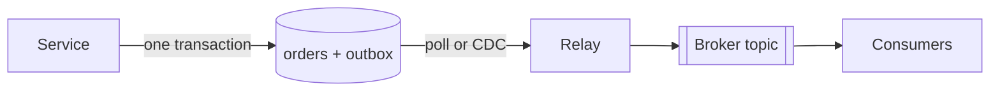

## The problem it solves

A common bug in event-driven systems is the **dual write**:

```python
db.save(order)                      # 1. commit to the database
broker.publish("OrderPlaced", order) # 2. publish the event
```

If the process crashes between steps 1 and 2, the order exists but no one hears about it: no confirmation email, no inventory update. Reverse the order and you can publish an event for an order whose transaction then rolls back. You can't make a database commit and a broker publish atomic, because they're separate systems.

## How it works

1. In the **same database transaction** as the business change, insert the event into an `outbox` table.
2. A separate **relay** reads new outbox rows and publishes them to the broker.
3. After a successful publish, the relay marks the rows as sent (or deletes them).

```sql
BEGIN;
INSERT INTO orders (id, customer_id, total) VALUES (42, 7, 99.00);
INSERT INTO outbox (id, aggregate_id, type, payload)
  VALUES (gen_random_uuid(), 42, 'OrderPlaced', '{"orderId":42,"total":99.00}');
COMMIT;
```

Either both rows commit or neither does, so an event exists **if and only if** the order does.



### Two ways to relay

- **Polling publisher:** a worker queries `SELECT ... FROM outbox WHERE sent = false ORDER BY created_at LIMIT 100` on a loop. Simple, but adds load and some latency.
- **Change data capture (CDC):** a tool like **Debezium** tails the database's write-ahead log or binlog and streams outbox inserts straight to Kafka. Low latency, no polling, and Debezium has a built-in outbox event router.

## Trade-offs

- **At-least-once:** the relay may publish an event and crash before marking it sent, so it publishes again. Consumers must be [idempotent](/principles/idempotency); include a unique event ID.
- **Ordering:** publish in commit order per aggregate (e.g. per order ID) and use that ID as the partition key.
- **Extra table and process** to run, monitor and clean up.
- **Latency:** events arrive slightly after the commit; fine for most workflows.

### The inbox, its mirror image

On the consuming side, an **inbox** table records processed event IDs in the same transaction as the consumer's own writes, making processing idempotent.

## In the real world

<Callout type="example" title="Outbox + CDC is the standard pairing">
The outbox pattern is a standard building block in microservice architectures, and Debezium's outbox event router exists specifically to support it: services write outbox rows, Debezium captures them from the database log, and routes each one to a Kafka topic based on its event type. Teams get reliable events without adding a broker call to every request.
</Callout>

Sagas depend on it: each saga step must reliably publish the event that triggers the next step, which the outbox guarantees. See [distributed transactions and sagas](/principles/distributed-transactions-and-sagas).

## Interview angle

<Callout type="interview">
Whenever a service "saves to the database and then publishes an event", point out the dual-write problem and fix it with an outbox table in the same transaction plus a CDC or polling relay. Add that consumers dedupe by event ID.
</Callout>

- Publishing inside the transaction (holds locks while calling the broker, and still isn't atomic).
- Assuming the relay delivers exactly once.
