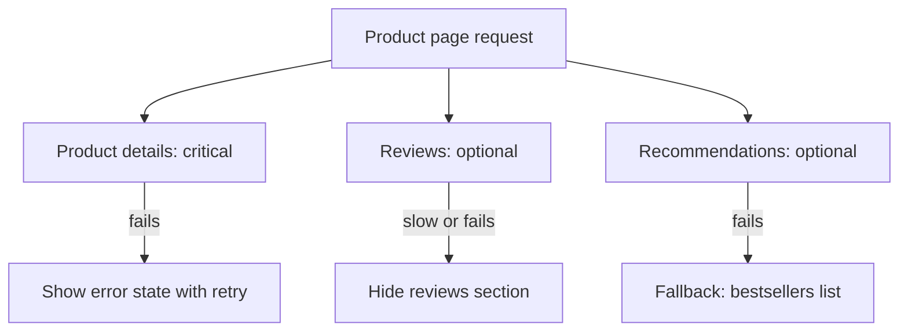

## The problem it solves

Designs and specs usually show the screen with perfect data. In production, data is loading, missing, partially available, stale or failing, and if nobody designed those states, engineers improvise: infinite spinners, blank pages, "Error: 500", or the whole page failing because one small widget's service is down.

## How it works

### The states every screen needs

| State | When | Good design |
|---|---|---|
| **Loading** | Data on its way | Skeleton of the layout; show cached data if you have it |
| **Empty** | Nothing exists yet | Explain what goes here and the first action to take |
| **Partial** | Some parts failed | Render what works; hide or placeholder the failed part |
| **Error** | The main action failed | Say what happened, whether data is safe, and what to do next |
| **Stale / offline** | Showing old data | Show it, with a quiet "last updated" or offline indicator |
| **Slow** | Taking longer than usual | After a few seconds, acknowledge it; offer cancel |

### Decide what's essential on each screen

For each page, classify every dependency:

- **Critical:** without it the page is pointless (the product details on a product page). If it fails, show an error state.
- **Optional:** reviews, recommendations, "people also bought". If it fails, hide the section or show a fallback.

That classification is a product decision, and it maps directly to engineering: optional dependencies get short [timeouts](/principles/timeouts-retries-and-backoff), [circuit breakers](/principles/circuit-breakers) and fallbacks so they can never take down the page. That's [graceful degradation](/principles/graceful-degradation).

### Write good error messages

Nielsen Norman Group's long-standing guidelines: errors should be visible, written in plain language, say precisely what went wrong, and suggest a fix, without blaming the user. Add the systems view: tell users **whether their data is safe** ("Your draft is saved; we'll send it when you're back online") and whether retrying is safe.

### Fallbacks that keep the product useful

- Cached or default content (popular items instead of personalized ones).
- Read-only mode when writes are failing.
- Queue the action locally and send later.
- Simpler versions of expensive features during overload.

## Trade-offs

- **Design and build effort:** each state costs time; prioritize critical journeys.
- **Honesty vs calm:** too many warnings erode trust, silent failures erode it more. Show problems that affect what the user is trying to do.
- **Fallback correctness:** stale or default data must never be mistaken for real, current data where it matters (balances, stock levels).

## In the real world

<Callout type="example" title="Netflix: fall back instead of failing">
Netflix's API wrapped dependency calls in its Hystrix library with timeouts, circuit breakers and a **fallback**, following the rule that no single dependency should take down the whole app. Netflix engineers describe the classic example: if personalized recommendations can't be generated, show rows that aren't personalized, such as what's popular, so the user still gets a working home screen. The experience degrades a little rather than breaking.
</Callout>

Large e-commerce sites follow the same pattern: during incidents, product pages keep working while non-essential widgets (recommendations, reviews, recently viewed) silently disappear.

## Interview angle

<Callout type="interview">
When you draw a page that depends on several services, say which ones are critical and which are optional, and what the user sees when each fails. That shows you connect architecture to user experience.
</Callout>

<Callout type="tip" title="For PMs">
Make "what happens when X is down or slow?" a standard spec section. For each screen, mark dependencies as critical or optional and sketch the empty, loading and error states with design.
</Callout>

- Infinite spinners with no timeout.
- A failing optional widget taking down the whole page.
- Error messages that don't say whether the user's work was saved.
