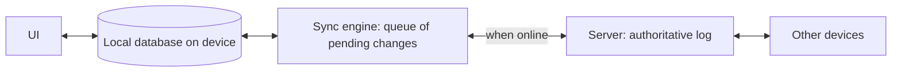

## The problem it solves

If every like, checkbox or rename waits for a server round trip, the app feels as slow as the worst network the user is on. On a train or in a basement, it stops working completely. Users expect apps to respond instantly, like local software.

## How it works

### Optimistic updates

1. The user acts (e.g. completes a task).
2. The UI updates **immediately**, as if the server had agreed.
3. The request goes to the server in the background, with an [idempotency key](/principles/idempotency) so retries are safe.
4. On success, nothing visible changes. On failure, roll back and tell the user clearly.

This fits actions that almost always succeed and are cheap to undo: likes, reordering, marking as read, editing your own content.

### When not to be optimistic

Don't pretend success for actions where failure is common or the consequences are serious: payments, booking the last seat, sending money, irreversible deletes. Show a pending state instead, and confirm only when the server has.

### Local-first: the next step

A **local-first** app keeps a full copy of the user's data on the device. Reads and writes go to the local database; a sync engine exchanges changes with the server and other devices in the background.

Benefits: instant interactions, offline support, and real-time collaboration falls out of the sync layer. Costs: you need a conflict strategy, the client holds data (which matters for security and storage), and schema changes have to work with old clients holding old data.

### Handling conflicts

Two devices edit the same thing offline. Options, from simple to sophisticated:

- **Last writer wins per field:** simple and often good enough (a task's title and due date are separate fields, so concurrent edits to different fields both survive).
- **Server decides:** the server orders changes and clients rebase their pending ones.
- **CRDTs:** data types designed so concurrent changes always merge, used for collaborative text. See [collaborative editor](/practice/design-collaborative-editor).

## Trade-offs

| | Pessimistic (wait for server) | Optimistic | Local-first |
|---|---|---|---|
| Feels | Slow on bad networks | Instant | Instant, works offline |
| Complexity | Low | Rollback paths | Sync engine, conflicts, migrations |
| Risk | None | Brief false success | Divergence if sync is buggy |

## In the real world

<Callout type="example" title="Figma: instant local edits, server as the authority">
Figma applies a user's changes locally right away and sends them to a server that is the authority for each document. Conflicts are resolved per property with last-writer-wins, which keeps the model simple, and the client briefly ignores server updates for properties it has unacknowledged changes to so they don't flicker back. See [How Figma's multiplayer editing works](/case-studies/figma-multiplayer).
</Callout>

Ink & Switch's 2019 essay **"Local-first software"** set out the ideals behind the movement (fast, multi-device, offline, collaborative, long-lived, private, user-owned) and argued that CRDTs make it practical. Products like Linear built their apps around a local data store with a sync engine, which is a big part of why they feel fast.

## Interview angle

<Callout type="interview">
Say which actions you'd make optimistic and which you wouldn't, and why. Describe the failure path: idempotent retries, rollback, and a clear error. If offline matters, describe local storage, a pending-changes queue, and your conflict strategy.
</Callout>

<Callout type="tip" title="For PMs">
Decide with engineering which actions can show success before the server confirms, and design the failure message for each. Ask whether offline use is a real requirement; it changes the architecture far more than most features.
</Callout>

- Optimistic UI for payments or other high-stakes actions.
- No rollback or error path, so failed actions silently vanish.
- Offline support added late, after the data model assumed the server is always reachable.
