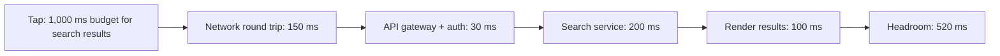

## The problem it solves

A product can have every feature users asked for and still feel bad because each tap takes a second. Slowness rarely shows up as a single bug; it creeps in one extra API call, one larger bundle, one unindexed query at a time, until the app feels sluggish and nobody owns it.

## How it works

### Know the human thresholds

Google's RAIL model gives rough targets grounded in how people perceive delay:

- **Respond** to input within about **100 ms**, and the action feels instant.
- **Animate** at 60 frames per second, so about 10 ms of work per frame.
- **Load** and become interactive quickly; past a few seconds users start to leave.

### Measure what users feel

Server latency is only part of it. Google's **Core Web Vitals** measure real user experience in the browser, evaluated at the 75th percentile of page loads:

| Metric | Measures | "Good" threshold |
|---|---|---|
| Largest Contentful Paint (LCP) | Loading: when the main content appears | ≤ 2.5 s |
| Interaction to Next Paint (INP) | Responsiveness to taps and clicks | ≤ 200 ms |
| Cumulative Layout Shift (CLS) | Visual stability: content jumping around | ≤ 0.1 |

Collect these from real users (real user monitoring), not only from lab tests on fast laptops, and break them down by device and country. A median user on a fast network hides the [tail](/principles/tail-latency).

### Set a latency budget

Pick a target for each critical interaction, then split it across the layers, like a financial budget:

Every new feature that adds a call has to fit in the budget or buy room by removing something else.

### Techniques that buy the most

- **Do less on the critical path:** load only what the first screen needs; defer the rest.
- **Move data closer:** [CDNs](/principles/cdn-and-edge-caching) for assets, [caches](/principles/caching-strategies) for hot data.
- **Avoid waterfalls:** fetch in parallel, or have the server return everything a screen needs in one response.
- **Perceived performance:** skeleton screens, optimistic updates and progressive loading make waits feel shorter. See [optimistic UI](/principles/optimistic-ui-and-local-first).

## Trade-offs

- **Features vs speed:** every extra widget costs milliseconds; a budget makes the trade explicit.
- **Freshness vs speed:** caching makes things fast but stale.
- **Engineering time:** chasing the last 50 ms on a rarely used page is rarely worth it; focus on critical journeys.

## In the real world

Google uses Core Web Vitals as one of the signals in search ranking, which is one reason many companies track them as product KPIs. Teams that take performance seriously typically add **performance budgets to CI** (fail the build if the JavaScript bundle or LCP in a lab test regresses past a threshold) and show real-user percentiles on the same dashboards as conversion.

## Interview angle

<Callout type="interview">
Name a latency target for the key user action, say which percentile, and show how the request path fits inside it. Mention where you'd cache and what you'd defer. For client-heavy products, mention Core Web Vitals and real-user monitoring.
</Callout>

<Callout type="tip" title="For PMs">
Put latency targets in the spec next to the feature ("results visible in under 1 s at p75 on mid-range Android phones") and give a performance regression the same priority as a functional bug.
</Callout>

- Measuring only averages, only server time, or only on office Wi-Fi.
- Adding requests to the critical path without anyone owning the total.
- Treating performance as a one-off project instead of a budget that's enforced.
