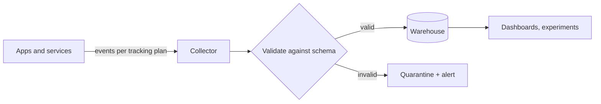

## The problem it solves

A team launches a feature and asks "did it work?" Nobody added tracking, or the events that exist are inconsistent, or the dashboard shows page views going up while customers churn. Without agreed metrics and reliable instrumentation, product decisions fall back to opinion.

## How it works

### Choose metrics from goals

Google researchers proposed the **HEART** framework for user-centered metrics:

| Category | Question | Example metric |
|---|---|---|
| **H**appiness | Do users like it? | Satisfaction survey score |
| **E**ngagement | How much do they use it? | Active days per week per user |
| **A**doption | Do new users start using it? | % of new users who create a project in week 1 |
| **R**etention | Do they come back? | % of users active 30 days later |
| **T**ask success | Can they do what they came for? | Checkout completion rate, time to complete |

The paper pairs it with a **Goals → Signals → Metrics** process: state the goal, decide which user behavior would signal progress, then define a metric you can compute.

### Primary metrics and guardrails

- **North star / primary metric:** the one number that best captures value delivered (e.g. messages sent by teams, nights booked).
- **Guardrail metrics:** must not get worse while you improve the primary metric: latency, error rate, crashes, unsubscribes, support tickets, revenue.
- **System health metrics:** the engineering side, [SLIs and SLOs](/principles/slis-slos-and-error-budgets) for availability and latency, are product metrics too: slow or failing pages lower every other number.

### Instrument deliberately

- Write a **tracking plan**: each event's name, when it fires, its properties and owner, reviewed like code. See [analytics event design](/principles/analytics-event-design).
- Send critical business events (orders placed, subscriptions started) from the **server**, where they're reliable; use client events for UI behavior.
- Validate events against the plan and alert on breakage; see [data contracts and quality](/principles/data-contracts-and-quality).

## Trade-offs

- **Leading vs lagging:** retention and revenue are what matter but move slowly; leading indicators (activation in week 1) move fast but can mislead.
- **Measurable vs meaningful:** easy metrics (clicks, time on page) can reward the wrong behavior. More time on a support page may mean users are stuck.
- **Tracking vs privacy:** collect what you'll use, with consent where required; see [PII and privacy](/principles/pii-privacy-and-retention).

## In the real world

Google's HEART paper (Rodden, Hutchinson and Fu, CHI 2010) came from Google's UX research teams needing metrics at the scale of products like Gmail and YouTube, where traditional usability studies couldn't capture behavior across millions of users. Its central advice, start from goals rather than from whatever data is easy to log, remains the most common failure point in analytics.

Twilio Segment's tracking plan guidance recommends a small number of well-named core events with rich properties, rather than hundreds of narrowly named events nobody can interpret.

## Interview angle

<Callout type="interview">
For product design or "how would you measure success" questions, state the goal, a primary metric, two or three guardrails, and how you'd instrument it. In system design, mention emitting business events and how they reach analytics without slowing the request path.
</Callout>

<Callout type="tip" title="For PMs">
Define success metrics and the events needed to compute them in the spec, before engineering starts. Check the instrumentation in staging before launch; you can't measure retroactively.
</Callout>

- Launching first and adding tracking after.
- Optimizing one metric with no guardrails.
- Relying on client-side events for revenue-critical numbers.
