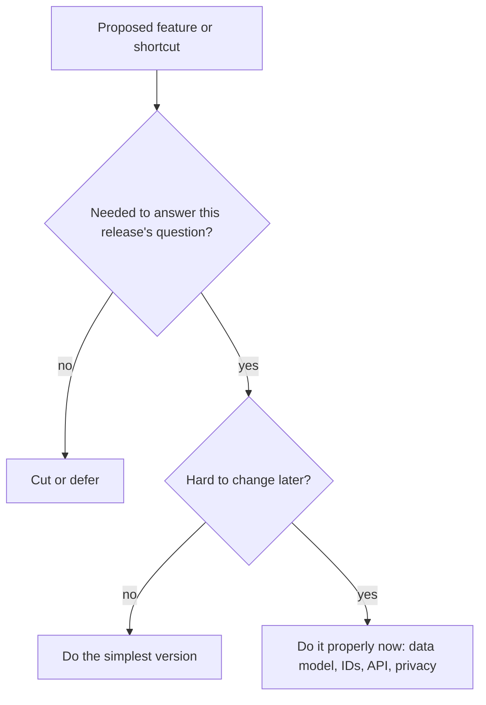

## The problem it solves

Teams either agonize over every choice (and ship slowly) or rush everything (and get stuck with a data model or public API they can't change). Both come from treating all decisions as equally risky.

## How it works

### One-way and two-way doors

In his 2015 letter to shareholders, Jeff Bezos described two types of decisions. **Type 1** decisions are consequential and nearly irreversible, "one-way doors", and deserve slow, careful deliberation. **Type 2** decisions are reversible, "two-way doors", and should be made quickly by small groups. His warning: as organizations grow, they tend to use the heavy Type 1 process for everything, which makes them slow and timid.

### Which technical decisions are one-way doors?

| Usually hard to reverse | Usually easy to reverse |
|---|---|
| Public API contracts and URLs | Internal APIs between your own services |
| Core data model, IDs and tenancy model | UI layout, copy, onboarding flow |
| Data you've promised to keep or delete | Which cache or queue library you use |
| Pricing and what's in each plan | Feature flag defaults |
| Security and privacy promises to users | Most infrastructure sizing |
| Choice of primary database (after data grows) | Algorithms behind a stable interface |

The pattern: decisions that leak to **customers** or into **stored data** are expensive to undo. Decisions hidden behind an interface are cheap.

### Turn one-way doors into two-way doors

- Put a **stable interface** in front of things you might change.
- Ship behind [feature flags](/principles/feature-flags-and-experimentation) so you can turn things off.
- Launch to a small group first (beta, one region, internal users).
- Plan migrations with **expand and contract** (Martin Fowler's *parallel change*): add the new thing alongside the old, move users over, then remove the old. See [zero-downtime migrations](/principles/zero-downtime-schema-migrations).
- Avoid public commitments until you've learned enough.

### Scope the MVP around a question

A minimum viable product exists to **learn** something: will people use it, will they pay, does it work at our scale? Cut everything that doesn't help answer that question, but don't cut the things that are one-way doors:

Shortcuts in UI and features are fine. Shortcuts in the data model, IDs, tenancy, security and public APIs usually cost far more to fix later than to get right the first time.

## Trade-offs

- **Speed vs optionality:** keeping options open has a cost (abstractions, flags); don't add them for things you'll never change.
- **Misclassification:** the biggest risk is treating a one-way door as two-way ("we'll fix the IDs later") or the reverse.
- **Small MVPs disappoint:** set expectations that v1 is for learning.

## In the real world

Amazon's framing became widely adopted in tech: teams explicitly ask "is this a one-way or two-way door?" in design reviews to decide how much process a decision deserves.

On the engineering side, many painful migrations in this guide's case studies are one-way doors that were treated as two-way ones early on: Twitter replacing sequential IDs with Snowflake IDs when moving databases, or Notion re-sharding its single Postgres database by workspace. See [How Notion sharded Postgres](/case-studies/notion-sharding-postgres).

## Interview angle

<Callout type="interview">
When you make a simplifying choice in a design, say whether it's reversible. "We'll start with a single database; that's reversible because we key everything by tenant ID, so we can shard by tenant later." That shows you know where the expensive decisions are.
</Callout>

<Callout type="tip" title="For PMs">
Ask engineering "which of these decisions are hard to undo?" and spend review time there. For everything else, agree to decide quickly, ship behind a flag, and learn.
</Callout>

- Heavy process for cheap decisions, little thought for expensive ones.
- Cutting corners on IDs, tenancy or public APIs to ship an MVP faster.
- MVPs that try to answer every question at once.
