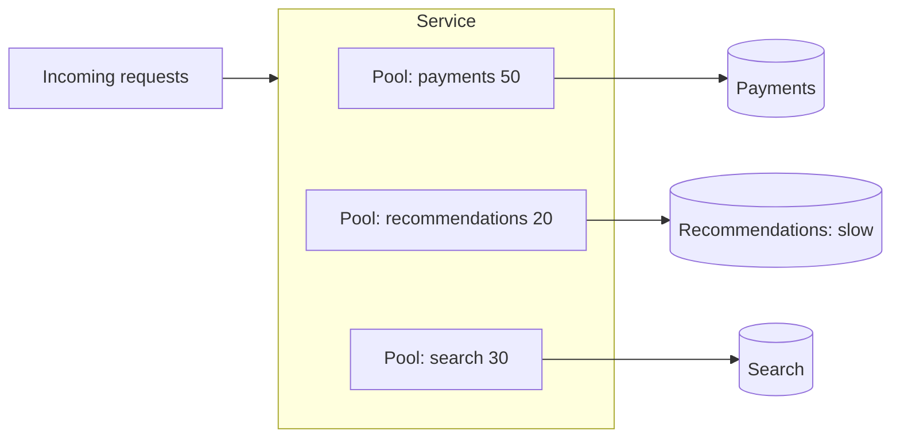

## The problem it solves

If every request in a service shares one pool of 200 threads and one dependency slows down, requests to that dependency pile up and take all 200 threads. Requests that have nothing to do with the slow dependency now wait too. The same happens at larger scales: one tenant's traffic spike, one bad batch job or one shared cache can take down everything that shares it.

## How it works

Divide shared resources into isolated compartments, sized so that one filling up leaves the others working.

### Within a service

- **Separate thread pools or concurrency limits per dependency:** the recommendations client gets 20 concurrent calls, payments gets 50. If recommendations hangs, only its 20 slots fill.
- **Separate connection pools** per downstream database or service.
- **Separate queues** for different priorities or job types, so a flood of low-priority jobs doesn't delay critical ones.

### Across a system

- **Separate clusters for different workloads:** interactive traffic and batch jobs on different instances or databases.
- **Per-tenant limits** and quotas, so one customer can't use all capacity. See [rate limiting](/principles/rate-limiting).
- **Cells and pods:** full copies of the stack, each serving a subset of customers. See [cell-based architecture](/principles/cell-based-architecture).
- **Shuffle sharding:** each customer gets a random subset of servers, so customers rarely share their entire set.

## Trade-offs

- **Less efficient:** idle capacity in one compartment can't help a busy one. You trade utilization for isolation.
- **Sizing is hard:** too small and a compartment starves under normal load; too large and it doesn't protect anything.
- **More things to monitor and configure.**
- **Isolation must include shared dependencies.** Separate app clusters that share one database or cache aren't really isolated.

## In the real world

<Callout type="example" title="Shared dependencies sink ships">
Shopify's database sharding didn't stop a shared Redis outage from taking down every store, so it moved to pods with fully isolated datastores. See [Shopify's pods architecture](/case-studies/shopify-pods). Roblox's single Consul cluster for all workloads made its 2021 outage platform-wide; it later split Consul by workload. See [Roblox's 73-hour outage](/postmortems/roblox-consul-2021).
</Callout>

Netflix's Hystrix library ran each dependency's calls in its own small thread pool by default, a direct application of bulkheads inside a single service.

## Interview angle

<Callout type="interview">
When a design has one service calling many dependencies, mention per-dependency concurrency limits. When it's multi-tenant, mention per-tenant quotas and, for large systems, cells. Say what's shared and why that's acceptable.
</Callout>

- One shared pool for everything.
- "Isolated" services that share a single database.
