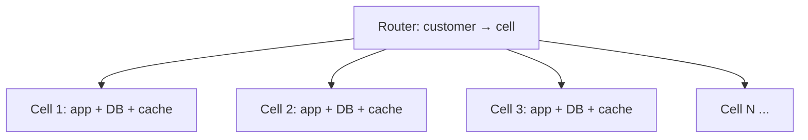

## The problem it solves

Even a well-replicated service has failure modes that hit everything at once: a bad deploy, a poison request that crashes every server, a runaway customer workload, a scaling limit that the whole fleet crosses together. Replication protects against machines dying; it doesn't protect against **the same bug running everywhere**.

## How it works

Split the service into **cells**: complete, independent copies of the whole stack (compute, storage, caches, queues), each serving a subset of customers or resources.

- A thin **routing layer** maps each request to its cell, usually by a partition key such as customer ID, account ID or resource ID.
- Cells **share nothing**: no cross-cell calls, no shared databases.
- Each cell has a **maximum size**, so the system grows by adding cells rather than making cells bigger. Once tested at maximum size, a cell's behaviour is known.
- **Deployments go cell by cell**, so a bad release hits one cell first.

With 10 cells, a failure confined to one cell affects about 10% of customers, instead of all of them.

### Design rules

- **Keep the router as simple and stable as possible:** it's the one shared component. It should be a lookup, not business logic, and keep working from its last known mapping if its data store fails.
- **Make tenants movable** between cells, to balance load and isolate very large customers.
- **Control plane vs data plane:** creating and moving cells is control-plane work; serving requests is the data plane, which should never depend on the control plane being up.

## Trade-offs

- **Cost:** many smaller copies are less efficient than one big pool, and each cell needs headroom.
- **Cross-cell features are hard:** anything that needs data from many customers at once (global search, analytics, admin views) needs a separate system.
- **Operational overhead:** more deployments, dashboards and capacity to manage, usually requiring strong automation.
- **Cells don't help with router bugs** or global dependencies like a shared identity service; minimize those.

## In the real world

<Callout type="example" title="AWS: cells everywhere">
AWS uses cells widely, and its whitepaper on cell-based architecture describes the approach for any workload. After the 2017 S3 outage, AWS prioritized splitting S3's index subsystem into smaller cells. After the 2020 Kinesis outage, it accelerated cellularizing the Kinesis front-end fleet, whose all-to-all design had hit an OS thread limit. See [The S3 outage caused by one mistyped command](/postmortems/aws-s3-us-east-1-2017) and [The Kinesis outage](/postmortems/aws-kinesis-us-east-1-2020).
</Callout>

Shopify's **pods** are cells: each pod is a group of shops on fully isolated datastores, with stateless app servers routed to one pod per request. See [Shopify's pods architecture](/case-studies/shopify-pods). Route 53 combines cells with **shuffle sharding** to isolate customers from each other's attacks. See [Shuffle sharding at Amazon Route 53](/case-studies/aws-shuffle-sharding).

## Interview angle

<Callout type="interview">
For a large multi-tenant system, propose cells: "customers are assigned to cells of fixed maximum size; a stateless router maps customer ID to cell; deploys go one cell at a time". State the blast radius ("a bad deploy affects at most one cell, about 5% of customers").
</Callout>

- Cells that secretly share a database or cache.
- A router full of logic that becomes a single point of failure.
