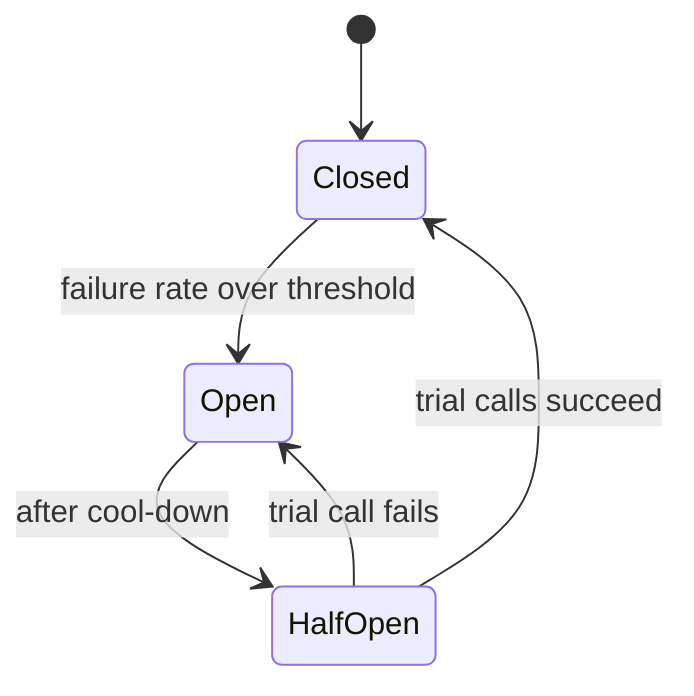

## The problem it solves

Your service calls a recommendations service that has started timing out after 2 seconds. Every request to your service now waits 2 seconds, holds a thread and a connection the whole time, and then fails anyway. Under load, your thread pool fills up and **your** service stops responding, even for requests that don't need recommendations. The failure has cascaded.

Retrying makes it worse. What you want is to notice the dependency is broken and **stop calling it** for a while.

## How it works

A circuit breaker wraps calls to a dependency and tracks their outcomes. It has three states:

- **Closed:** calls pass through normally. The breaker counts failures and slow calls over a rolling window.
- **Open:** once failures cross a threshold (say, 50% of the last 20 calls, or 5 timeouts in a row), the breaker opens. Calls **fail immediately** without touching the dependency, and the caller uses a fallback.
- **Half-open:** after a cool-down (e.g. 30 seconds), a few trial calls are allowed through. If they succeed, the breaker closes; if not, it opens again.

### Fallbacks

When the breaker is open, return something useful instead of an error where possible:

- A cached or default value (generic recommendations, last known price).
- A reduced response (the page without the recommendations panel).
- A clear, fast error for things that genuinely can't be faked (payments).

See [graceful degradation](/principles/graceful-degradation).

## Trade-offs

- **Tuning:** thresholds too sensitive cause flapping; too lenient and the breaker opens too late. Count slow calls as failures too.
- **Per-dependency, and sometimes per-endpoint:** one bad endpoint shouldn't open the breaker for a whole service.
- **Fallbacks must be tested;** a fallback that throws is worse than no fallback.
- **Breakers in many clients don't coordinate,** so some keep sending traffic while others have opened. That's usually fine; load shedding on the server side complements it.

## In the real world

<Callout type="example" title="Netflix Hystrix">
Netflix popularized circuit breakers in microservices with **Hystrix**, open-sourced in 2012. It wrapped every call to a dependency with a timeout, a circuit breaker and a fallback, and ran calls in separate thread pools per dependency (a [bulkhead](/principles/bulkheads)), so one slow service couldn't consume all threads. Netflix put Hystrix into maintenance mode in 2018 and moved toward adaptive approaches; the ideas live on in libraries like Resilience4j and in service meshes such as Istio and Envoy, which apply outlier detection and circuit breaking at the proxy layer.
</Callout>

Michael Nygard's book *Release It!* introduced the pattern to software in 2007, borrowing the idea from the electrical breakers that protect a house's wiring.

## Interview angle

<Callout type="interview">
For non-critical dependencies in your design, say: "calls go through a circuit breaker with a short timeout; if it opens, we serve cached recommendations". For critical ones, explain how the breaker makes failures fast and visible rather than slow.
</Callout>

- Circuit breakers without timeouts (a hang never counts as a failure).
- No fallback, or a fallback that's never been exercised.
