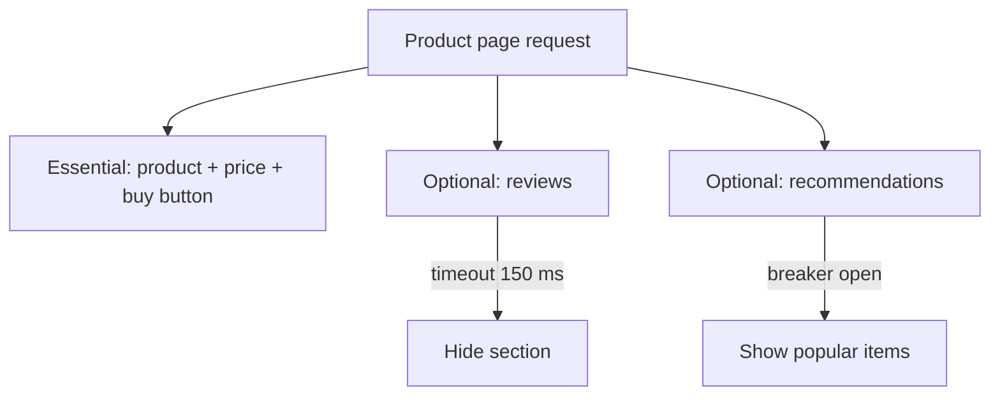

## The problem it solves

A product page depends on pricing, inventory, reviews, recommendations, ads and personalization. If any one of them is down and the page waits for all of them, a failure in the least important feature takes down the most important one. Users see an error instead of a slightly simpler page.

## How it works

### Rank features by importance

For each user journey, list what's **essential** (show the product and let people buy it) and what's **nice to have** (reviews, recommendations, recently viewed). Essential paths get the strongest guarantees; optional features must never block them.

### Degrade, don't fail

| Failure | Degraded behaviour |
|---|---|
| Recommendations down | Show popular items, or hide the panel |
| Personalization slow | Serve the generic page from cache |
| Search index lagging | Serve slightly stale results |
| Image service overloaded | Serve lower-resolution images |
| Write path impaired | Allow reads; queue writes for later |

### Techniques

- **Timeouts plus fallbacks** for every optional dependency, often through a [circuit breaker](/principles/circuit-breakers).
- **Kill switches / feature flags** to turn expensive features off instantly during incidents.
- **Serve stale:** cached data past its TTL beats an error for many reads.
- **Fail open for non-critical checks:** if a quota or analytics check is unavailable, let the request through rather than reject it (but never for security checks).
- **Priority-based load shedding:** drop the least important traffic first when overloaded.

## Trade-offs

- **Fallbacks are code paths that rarely run,** so they rot. Test them, ideally with chaos experiments.
- **Degraded modes can hide problems;** alert on them so someone fixes the root cause.
- **Users must not be misled:** showing a stale balance or a fake "in stock" can be worse than an honest error. Choose fallbacks per data type.
- **Fail-open is dangerous for security:** authentication and authorization must fail closed.

## In the real world

<Callout type="example" title="Netflix keeps playback alive">
Netflix's prioritized load shedding is graceful degradation at scale: when systems are stressed, non-essential requests such as logging and prefetching are throttled first, so starting and continuing playback, the one thing members care about most, keeps working.
</Callout>

Google Cloud's June 2025 outage shows the cost of not degrading: a crash in a non-essential quota-checking feature took down Service Control entirely. Google's fix includes making features **fail open** so a bug in one check doesn't block every API call. See [A blank field crashes Google Cloud's API gateway](/postmortems/google-cloud-service-control-2025).

## Interview angle

<Callout type="interview">
Identify the core path of your design and say what happens when each optional dependency fails: "If recommendations time out after 150 ms, we render the page without them". Mention kill switches for expensive features during incidents.
</Callout>

- Every feature treated as critical.
- Fallbacks that have never been tested.
