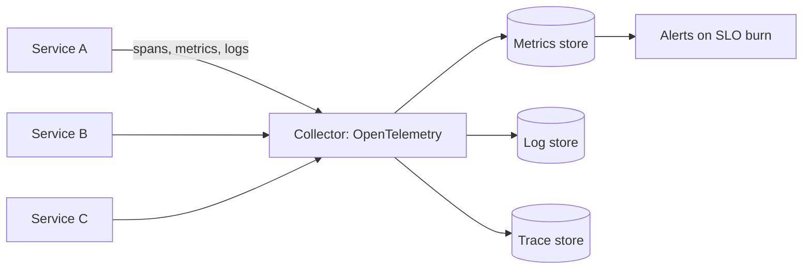

## The problem it solves

A user request might pass through a load balancer, an API gateway, ten services, two caches and three databases. When it's slow or fails, which one is responsible? Without good telemetry, engineers guess, and outages last longer. Many postmortems include the line "it took us N hours to figure out what was going on".

## How it works

### The three signals

| Signal | What it is | Good for |
|---|---|---|
| **Metrics** | Numbers over time: request rate, error rate, latency percentiles, CPU, queue depth | Dashboards, alerts, trends; cheap to store |
| **Logs** | Timestamped records of events, ideally structured (JSON) | Detail on specific requests and errors |
| **Traces** | The path of one request across services, with timing for each step (spans) | Finding which hop is slow or failing |

Correlate them with a shared **request or trace ID**, propagated through every call and included in every log line.

### What to measure

- For request-driven services, Google's **four golden signals**: latency, traffic, errors and saturation.
- The **RED** method (Rate, Errors, Duration) per service, and **USE** (Utilization, Saturation, Errors) per resource.
- **User-facing SLIs** first; internal metrics second. See [SLIs, SLOs and error budgets](/principles/slis-slos-and-error-budgets).

### Alerting

- Page on **symptoms users feel** (SLO burn rate), not on every cause (one server's CPU).
- Every page should be urgent and actionable; everything else is a ticket or a dashboard.
- Watch from outside too: synthetic checks and external monitors catch failures your internal metrics miss.

## Trade-offs

- **Cost:** logs and traces at full volume get expensive. Sample traces (keeping all errors and slow requests), and set log retention.
- **High-cardinality labels** (user ID as a metric label) can overwhelm metrics systems; put that detail in logs or traces.
- **Alert fatigue:** too many alerts and people ignore all of them.
- **Your monitoring must survive your outage:** if telemetry depends on the system that's failing, you go blind exactly when you need it.

## In the real world

<Callout type="example" title="Google Dapper and distributed tracing">
Google's 2010 Dapper paper described tracing requests across thousands of machines with very low overhead by sampling only a fraction of requests. It inspired Zipkin (Twitter), Jaeger (Uber) and eventually the **OpenTelemetry** standard, which most companies now use to collect traces, metrics and logs in a vendor-neutral way.
</Callout>

Several postmortems turn on observability failures: Roblox's monitoring depended on the Consul cluster that was failing; Slack's dashboards degraded with its network, and an external monitor raised the first alarm; Knight Capital's warning emails were sent but not treated as alerts. See [Roblox's 73-hour outage](/postmortems/roblox-consul-2021), [Slack's first-day-back outage](/postmortems/slack-2021-january) and [Knight Capital](/postmortems/knight-capital-2012).

## Interview angle

<Callout type="interview">
Close any design by saying how you'd know it's healthy: "SLO dashboards on availability and p99 latency, burn-rate alerts, distributed tracing with a request ID across services, structured logs". Mention monitoring from outside the system.
</Callout>

- Alerting on CPU instead of user experience.
- Monitoring that shares fate with production.
