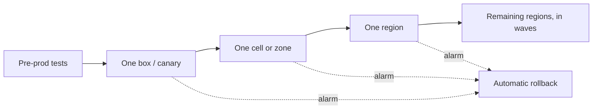

## The problem it solves

Look through the postmortems on this site and a pattern stands out: CrowdStrike's content update, Cloudflare's WAF rule, Google Cloud's Service Control policy, Knight Capital's deploy and Facebook's maintenance command were all **changes** that went everywhere at once. Systems are mostly stable when left alone; it's what we push to them that breaks them.

You can't stop changing things, but you can control **how many users a bad change reaches before you notice**.

## How it works

### Stages and waves

Roll out in steps of increasing size, with a pause and health check between each:

- **Canary:** deploy to a small slice (one server, 1% of traffic) and compare its error rate and latency with the rest.
- **Bake time:** wait long enough for problems to surface: minutes for crashes, hours for leaks.
- **Waves:** expand to one availability zone, one region, then more regions, never all at once.
- **Automatic rollback:** if alarms fire, stop and revert without waiting for a human.

### Feature flags

Ship code dark (turned off), then enable the **behaviour** gradually: internal users, 1%, 10%, 50%, everyone. Flags separate deploy from release and give a kill switch. Google's 2025 outage happened partly because new code wasn't behind a flag, so a staged binary rollout never exercised the new path.

### Treat config and data like code

Configuration files, firewall rules, feature-flag changes, routing tables, policy data and "content updates" all change behaviour. They need the same staged rollout, validation and rollback as code, even when there's pressure to push them fast.

### Make rollback safe

- Keep old and new versions compatible (database schema changes in expand/contract steps).
- Practise rollbacks, so they're routine.
- Know which changes are one-way, and treat them with extra care.

## Trade-offs

- **Slower rollouts:** a global deploy may take days at Amazon or Google scale. Emergency paths exist, but they should be rare and still staged where possible.
- **Canaries need good signals:** if your metrics can't distinguish a bad canary from noise, the canary is theatre. See [observability](/principles/observability).
- **Version skew:** during a rollout, old and new versions run together and must interoperate.
- **Small canaries can miss rare bugs** that only appear at scale or with unusual inputs.

## In the real world

<Callout type="example" title="Amazon's pipelines">
Amazon's Builders' Library describes deployment pipelines that move each change through test stages, then into production one box at a time, then one availability zone, then one region, in waves, with automated monitoring and rollback at every step. Teams can deploy many times a day because each change's blast radius is controlled automatically.
</Callout>

CrowdStrike's 2024 incident is the counterexample: content updates went to every sensor at once, and its remediation was to introduce canary and staged deployments for that content. See [CrowdStrike's faulty update](/postmortems/crowdstrike-channel-file-291-2024). Cloudflare's 2019 outage led it to stage WAF rule changes the same way. See [Cloudflare's global outage from one regular expression](/postmortems/cloudflare-waf-regex-2019).

## Interview angle

<Callout type="interview">
When asked how you'd deploy or operate your design, describe stages: canary, one zone, one region, then the rest, with automated rollback on SLO alarms, feature flags for risky behaviour, and the same process for config changes.
</Callout>

- Global config pushes with no canary.
- Feature flags that are never cleaned up (see Knight Capital).
