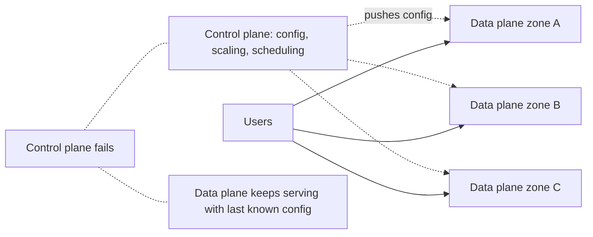

## The problem it solves

Many systems are designed to recover from failure by **reacting**: when a zone fails, launch new instances elsewhere; when config is lost, fetch it again; when a server dies, ask the scheduler for a replacement.

But during a large outage, the systems that react, like autoscaling APIs, schedulers, config services and DNS updates, are often impaired too. Everyone is trying to launch instances in the healthy zones at the same moment. A system that needs to make changes in order to survive can fail exactly when it's needed.

## How it works

A system is **statically stable** if it keeps working through a failure **without making any changes**.

### Pre-provision capacity

Instead of planning to launch instances in the remaining zones when one zone fails, run enough capacity in advance. For a service across three zones that must survive losing one, each zone runs 50% of peak load, so the remaining two can carry 100% immediately. It costs more, but no API call is needed during the failure.

### Separate control plane from data plane

- The **data plane** does the work (serves requests, forwards packets).
- The **control plane** configures the data plane (creates resources, pushes config, scales).
- Design the data plane to **keep running with its last known configuration** if the control plane disappears. Google calls this **fail static**.

### Cache what you depend on

- Keep the last known good config, service-discovery results and credentials locally, and keep using them if the source is unavailable.
- Don't make serving requests depend on a call that isn't strictly necessary.

## Trade-offs

- **Cost:** pre-provisioned spare capacity sits mostly idle.
- **Staleness:** running on cached config for too long has its own risks; define how long fail-static mode can safely last.
- **Discipline:** every new dependency on the request path weakens static stability; review designs for "what happens if X is down?"

## In the real world

<Callout type="example" title="AWS: design for the dependency being down">
AWS's Builders' Library describes how services like EC2 are designed so that running instances, the data plane, keep working even if the control plane for launching or modifying instances is impaired. Its guidance for customers is the same: pre-provision enough capacity across Availability Zones that losing one requires no reaction. AWS's 2025 us-east-1 outage illustrated the risk: EC2's instance-launch systems depended on DynamoDB, and new launches failed for hours after DynamoDB recovered. See [The DynamoDB DNS race condition](/postmortems/aws-dynamodb-dns-2025).
</Callout>

Google's 2019 network outage shows fail-static in action, and its limits: when maintenance automation removed the network's control plane, the network kept forwarding traffic on its last configuration for several minutes before routes were withdrawn. Google's fix was to extend that fail-static period. See [Google Cloud loses its network control plane](/postmortems/google-cloud-network-2019).

## Interview angle

<Callout type="interview">
When discussing zone or region failure, say whether your design is statically stable: "each zone runs at most 50% of peak so losing one zone needs no scaling", and "services cache discovery results and config so they keep running if the control plane is down".
</Callout>

- Relying on autoscaling to survive a zone failure.
- Request paths that call the control plane.
