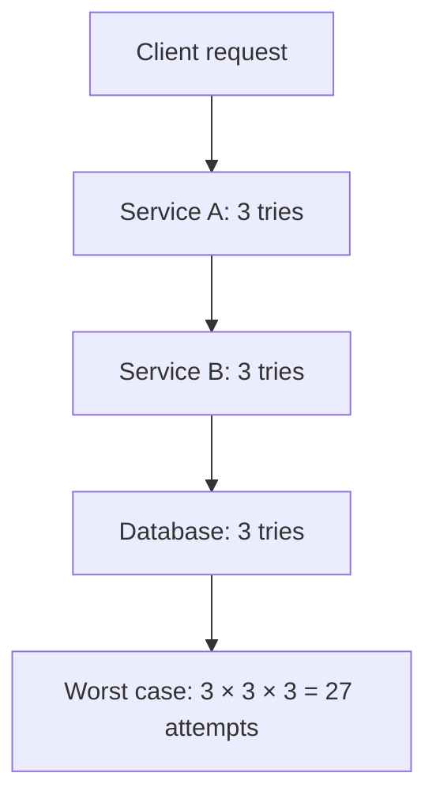

## The problem it solves

A call to another service can fail quickly, fail slowly, or hang forever. Without a timeout, a hung dependency ties up your threads and connections until your own service stops responding. And many failures are transient (a dropped packet, a server restarting), so trying again often works.

But retries have a dark side: when a dependency is struggling because it's overloaded, every client retrying multiplies the load on it, keeping it down.

## How it works

### Timeouts

- Set a timeout on **every** network call, including connection setup and DNS.
- Base it on measured latency: commonly a bit above the dependency's p99.9, so it rarely fires on healthy calls.
- **Propagate deadlines.** If the user's request has 2 seconds total and 1.5 have passed, downstream calls should get at most 0.5 seconds. gRPC supports this natively.

### Retry only what's safe

- Retry transient errors: timeouts, connection resets, 503s, 429s (respecting `Retry-After`).
- Don't retry client errors (400, 401, 404) or anything non-[idempotent](/principles/idempotency).

### Exponential backoff with jitter

Wait longer after each failed attempt, and randomize the wait:

```python
import random, time

def call_with_retries(fn, attempts=4, base=0.1, cap=5.0):
    for attempt in range(attempts):
        try:
            return fn()
        except TransientError:
            if attempt == attempts - 1:
                raise
            # "Full jitter": random delay between 0 and the exponential ceiling
            time.sleep(random.uniform(0, min(cap, base * 2 ** attempt)))
```

**Jitter matters as much as backoff.** Without it, clients that failed at the same moment retry at the same moment, in synchronized waves. AWS's analysis of backoff strategies found that adding randomness ("full jitter") spread retries out and cut total work significantly.

### Limit retries

- **Cap attempts** (often 2–3) and total time.
- **Retry at one layer only.** If the frontend, the API and the data layer each retry 3 times, one failing call can become 27 attempts at the bottom.
- **Retry budgets:** allow retries only while they're a small fraction of traffic (e.g. 10% extra). Once the budget is spent, fail fast.



## Trade-offs

- **Too short a timeout** causes needless failures and retries; **too long** ties up resources.
- **Retries add latency** for the user, and load for the dependency.
- **Retrying non-idempotent operations** creates duplicates.
- Retries hide problems; record and alert on retry rates.

## In the real world

<Callout type="example" title="Retry storms in real outages">
AWS's 2015 DynamoDB outage was amplified by storage servers retrying slow metadata requests, which kept the metadata service overloaded until engineers paused traffic to it. See [DynamoDB's metadata retry storm](/postmortems/aws-dynamodb-us-east-1-2015). In Google Cloud's June 2025 outage, Service Control tasks restarting without randomized backoff overloaded a Spanner database in us-central1 and prolonged recovery there. See [A blank field crashes Google Cloud's API gateway](/postmortems/google-cloud-service-control-2025).
</Callout>

The Amazon Builders' Library article describes the same practices AWS SDKs use by default: timeouts on every call, exponential backoff with jitter, retries at a single layer, and token-bucket-style limits so retries can't exceed a fraction of normal traffic.

## Interview angle

<Callout type="interview">
For every arrow between services in your diagram, be ready to say: timeout value, whether it retries, how many times, with backoff and jitter, and why the call is safe to retry. Mention deadline propagation for deep call chains.
</Callout>

- No timeouts on outbound calls.
- Immediate retries without jitter.
- Retrying at every layer.
