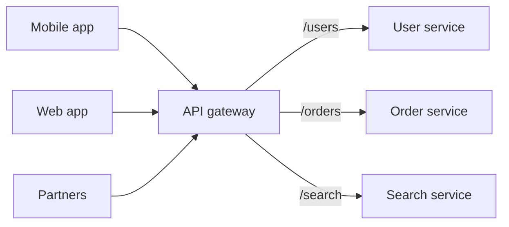

## The problem it solves

With dozens of backend services, clients would need to know every service's address, authenticate with each one, and make many round trips to assemble one screen. Each service would also re-implement the same cross-cutting concerns: TLS, auth, rate limits, logging, CORS.

## How it works

The gateway sits between clients and services:

Typical responsibilities:

- **Routing:** map public paths and versions to internal services.
- **Authentication:** validate tokens or API keys once; pass verified identity downstream in a header.
- **Rate limiting and quotas** per client or API key. See [rate limiting](/principles/rate-limiting).
- **Load shedding and priorities:** drop low-value traffic first when overloaded.
- **Protocol translation:** public REST/JSON in front, gRPC behind.
- **Observability:** one place for request logs, metrics and trace IDs.
- **Canary routing:** send a slice of traffic to a new version.

### Backend for frontend (BFF)

Different clients want different data shapes: a TV app, a phone app and a partner API all need different fields. A **BFF** is a gateway layer per client type that aggregates several backend calls into one tailored response, so the phone makes one request instead of seven.

## Trade-offs

- **A critical shared dependency.** Every request flows through it, so it must be highly available, horizontally scalable and fast. A bad gateway config push can take down everything at once.
- **Don't put business logic in it.** Gateways that accumulate product logic become a bottleneck that every team has to change.
- **Extra hop.** Usually a millisecond or two; worth it for what it centralizes.
- **Ownership.** One platform team typically runs it; routes and policies should be self-service so product teams aren't blocked.

## In the real world

<Callout type="example" title="Netflix Zuul: priorities at the front door">
Netflix routes device traffic through Zuul, its open-source gateway. In a 2020 post, Netflix described adding **prioritized load shedding** to Zuul: each request is given a priority based on what it does, with playback requests at the top and things like logging and prefetching lower. When a backend or Zuul itself is under strain, low-priority requests are rejected first, so viewers can keep pressing play during traffic spikes. Because every request already passes through the gateway, that one change protected the whole service.
</Callout>

Cloud providers offer managed versions (AWS API Gateway, Google Apigee, Azure API Management), and service-mesh proxies such as Envoy often play the same role at the edge.

## Interview angle

<Callout type="interview">
Put a gateway at the edge of a microservice design and list what it centralizes: TLS, auth, rate limits, routing. Then mention that it needs to be stateless and horizontally scaled, and that it's a good place for load shedding.
</Callout>

- Making the gateway a monolith full of business rules.
- Forgetting it needs redundancy and its own capacity planning.
