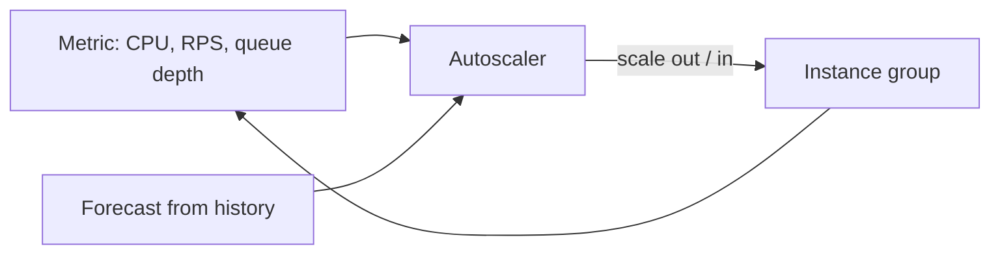

## The problem it solves

Traffic changes by the hour, the day and the season. Provisioning for the yearly peak wastes money most of the time; provisioning for the average falls over every evening. Manually adjusting capacity is slow and error-prone.

## How it works

An autoscaler watches a metric and adjusts the number of instances to keep it near a target.

### Reactive scaling

- **Target tracking:** "keep average CPU at 60%" or "keep 100 requests per second per instance". The controller computes the needed count: `desired = current × (current_metric / target)`.
- **Step scaling:** add N instances when a threshold is crossed, more for bigger breaches.
- **Queue-based:** scale workers on queue depth or age of the oldest message, which is a more direct signal for background jobs than CPU.

### Predictive and scheduled scaling

- **Scheduled:** add capacity before a known event (a product launch, the 9 a.m. login wave).
- **Predictive:** learn the daily and weekly pattern from history and scale ahead of the forecast. Reactive scaling then handles surprises on top.

### Making it work in practice

- **Scale on a metric that tracks load,** not one that lags. Request rate or concurrency often beats CPU.
- **Start-up time matters.** If an instance takes 5 minutes to boot and warm its caches, reactive scaling is always 5 minutes behind. Use smaller images, warm pools of pre-initialized instances, or predictive scaling.
- **Scale out fast, scale in slowly.** Use cooldowns and stabilization windows to avoid thrashing.
- **Set floors and ceilings.** A minimum that survives a zone failure; a maximum that protects the database and your budget.
- **Only stateless tiers scale this easily.** Databases and caches need rebalancing; scale them deliberately.

## Trade-offs

- **It's not instant.** Sudden spikes outrun reactive scaling; you still need headroom and [load shedding](/principles/backpressure-and-load-shedding) for the first minutes.
- **It can scale into a wall.** Adding app servers can overwhelm a shared database. Know your downstream limits.
- **Scale-in kills work.** Instances must drain connections and finish in-flight jobs before termination.
- **Depending on the control plane during an outage is risky.** If the scaling API is impaired during an incident, a fleet that needs to scale *up* to recover may not be able to. See [static stability](/principles/static-stability).

## In the real world

<Callout type="example" title="Predictive scaling at Netflix and AWS">
Netflix's traffic follows a strong daily pattern, peaking in the evening in each region. In 2013 Netflix described Scryer, an internal predictive autoscaling engine that forecast demand from historical patterns and provisioned instances ahead of time, because reactive policies alone reacted too late to steep ramps and over-reacted to outages. AWS later added predictive scaling as a built-in EC2 Auto Scaling feature that works the same way: forecast from history, scale ahead, and let reactive policies handle the rest.
</Callout>

Kubernetes' Horizontal Pod Autoscaler implements target tracking for containers, using CPU, memory or custom metrics, with a stabilization window that delays scale-in to prevent flapping.

## Interview angle

<Callout type="interview">
Say what metric you scale on and why, how long new instances take to become useful, and what protects you during that gap. Mention min/max limits, especially that the minimum should survive losing a zone.
</Callout>

- Autoscaling the database tier like a web tier.
- Ignoring start-up time and cache warm-up.
- No maximum, so a bug or attack scales up an enormous bill.
