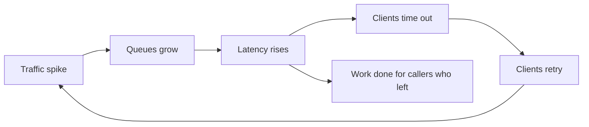

## The problem it solves

An overloaded server that keeps accepting requests doesn't just get a bit slower. Queues grow, every request waits longer, clients time out and **retry**, which adds even more load. Eventually the server spends all its time on requests whose callers have already given up. Throughput collapses to near zero even though the CPU is at 100%. This is congestion collapse.

## How it works

### Backpressure

Signal upstream to slow down instead of buffering without limit:

- **Bounded queues:** when the queue is full, reject new work immediately.
- **Concurrency limits:** cap in-flight requests per server. Adaptive limiters (like TCP congestion control) raise the limit while latency is healthy and cut it when latency climbs.
- **Flow control in streams:** consumers request the next N items (reactive streams, gRPC flow control, Kafka consumers pulling at their own pace).

### Load shedding

When over capacity, **reject cheaply and early** so the requests you do accept finish on time:

- Return `503` or `429` fast, before doing expensive work like database calls.
- **Prioritize:** shed background, prefetch and analytics traffic before user-facing requests, and new sessions before checkout.
- **Drop requests that are already doomed:** if a request has waited longer than the client's timeout, skip it. Propagate deadlines so downstream services can do the same.
- **Shed by cost:** a heavy search query is a better candidate than a cheap cache hit.

### Clients must cooperate

Retries need [exponential backoff with jitter](/principles/timeouts-retries-and-backoff) and a retry budget, or shedding just generates more retries.

## Trade-offs

- **Some users see errors.** That's the point: a fast error for 10% beats a timeout for 100%.
- **Getting the threshold right is hard.** Too low wastes capacity; too high lets collapse begin. Load-test to find the knee of the latency curve, and prefer adaptive limits over fixed numbers.
- **Priorities need consistent labelling.** Every client and service has to tag requests the same way.
- **Shedding isn't scaling.** It buys time; [autoscaling](/principles/autoscaling) or capacity planning fixes the shortfall.

## In the real world

<Callout type="example" title="Amazon: protect the goodput">
Amazon's Builders' Library article on load shedding explains that once a service passes its tipping point, latency rises until clients time out, so the server does work nobody receives. Amazon services shed excess load so that the requests they accept still meet latency goals. They also prioritize work, check whether a request's deadline has already passed before processing it, and load-test past the breaking point to verify that throughput stays flat under overload instead of collapsing.
</Callout>

Netflix's prioritized load shedding classifies requests by importance, with playback-critical requests highest and logs and prefetch lowest. When systems are stressed, lower-priority traffic is throttled progressively, so viewers can still start and keep watching. Netflix validates it with chaos experiments that inject load and failures.

Google's SRE book describes the same pattern with *criticality* labels attached to every RPC and propagated downstream, and per-client retry budgets to stop retries from amplifying overload.

## Interview angle

<Callout type="interview">
When the interviewer asks "what if traffic spikes 10×?", don't just say "autoscale". Autoscaling takes minutes. Explain what happens in the first 60 seconds: bounded queues, concurrency limits, shedding low-priority traffic, and clients backing off with jitter.
</Callout>

- Unbounded queues ("we'll just buffer it").
- Retrying immediately and without limits.
- Shedding after doing the expensive part of the work.
