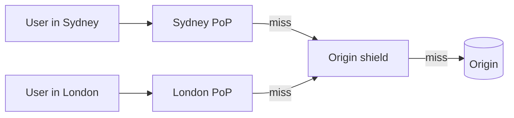

## The problem it solves

Light in fiber covers about 200 km per millisecond. A user in Sydney fetching an image from a server in Virginia waits well over 200 ms per round trip before any bytes arrive, and a web page needs many round trips. Meanwhile, every one of those requests uses origin bandwidth and CPU, even though millions of users are downloading the exact same file.

## How it works

A CDN is a network of cache servers (points of presence, or PoPs) in hundreds of locations. DNS or anycast routing sends each user to a nearby PoP.

1. The user requests `cdn.example.com/logo.png`.
2. The nearest PoP checks its cache. On a **hit**, it responds immediately.
3. On a **miss**, it fetches from the origin (often via a regional "shield" cache, so the origin sees one request instead of one per PoP), stores the response and serves it.



### Controlling what gets cached

HTTP headers from the origin decide caching behaviour:

```http
Cache-Control: public, max-age=31536000, immutable      # fingerprinted assets
Cache-Control: public, max-age=60, stale-while-revalidate=300   # API data that can be briefly stale
Cache-Control: private, no-store                        # per-user or sensitive responses
```

- **Fingerprint static files** (`app.3f9a1c.js`). The URL changes whenever content does, so you can cache forever and never purge.
- **Purge or use short TTLs** for content at fixed URLs.
- **Never cache personalized responses publicly.** A missing `private` header has leaked one user's page to others on more than one site.

### Beyond static files

Modern CDNs also terminate TLS near users, absorb DDoS attacks, run WAF rules, cache API responses and execute code at the edge.

## Trade-offs

- **Stale content.** Anything cached can be out of date. Pick TTLs per content type and plan how to purge.
- **Cache-key mistakes.** Including a random query parameter in the key kills the hit rate; leaving out a header that changes the response (like `Accept-Language`) serves the wrong content.
- **A new shared dependency.** When a major CDN has an outage, thousands of sites go down at once. High-traffic sites sometimes use two CDNs.
- **Cost model.** CDNs charge per GB and per request; at enormous scale, some companies build their own.

## In the real world

<Callout type="example" title="Netflix Open Connect: a CDN inside your ISP">
Netflix built its own CDN, Open Connect. It provides storage appliances (Open Connect Appliances) free of charge to qualifying internet service providers, which install them inside their own networks; Netflix says it works with over a thousand ISPs this way. The appliances are filled during off-peak hours with the titles predicted to be popular in that area, so when you press play, the video usually streams from a server inside your ISP rather than across the internet.
</Callout>

The general lesson applies at any scale: the cheapest, fastest request is one your origin never sees.

## Interview angle

<Callout type="interview">
For anything with images, video or static assets, put a CDN in front early and mention cache headers and fingerprinted URLs. For read-heavy APIs, mention caching public responses at the edge with short TTLs and `stale-while-revalidate`.
</Callout>

- Serving large media directly from application servers.
- Caching user-specific pages under a public cache key.
