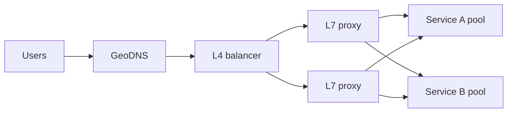

## The problem it solves

Once you have more than one server, clients need a single address to call, traffic needs to be shared fairly, and broken servers need to stop receiving requests, all without clients knowing any of it is happening.

## How it works

### Where load balancing happens

- **DNS / global:** returns different IP addresses per region or per user location. Coarse and slow to change because of caching, but it steers traffic across the world.
- **Layer 4 (transport):** routes TCP/UDP connections by IP and port without reading the request. Very fast; used for the first hop into a datacenter.
- **Layer 7 (application):** reads HTTP. Can route by path, header or cookie, terminate TLS, retry, and add auth or rate limits. Examples: NGINX, Envoy, HAProxy, AWS ALB.
- **Client-side:** the client library picks a backend from a list provided by [service discovery](/principles/service-discovery). Common inside large microservice fleets because it removes a hop.

### Algorithms

| Algorithm | How it picks | Good for |
|---|---|---|
| Round robin | Next server in order | Identical servers, uniform requests |
| Weighted round robin | Proportional to capacity | Mixed hardware |
| Least connections / least requests | Server with the fewest active requests | Requests with varying cost |
| Power of two choices | Pick 2 at random, send to the less loaded | Large fleets; near-optimal with little coordination |
| Consistent hashing | Hash of a key such as user ID | Cache affinity, sticky routing ([consistent hashing](/principles/consistent-hashing)) |

### Health checks

The balancer probes each backend (for example `GET /healthz` every few seconds) and stops sending traffic after a few failures. Pair active checks with **passive** ones: watch real responses and eject a server that starts returning errors or timing out.

## Trade-offs

- **The balancer is in every request path.** Run it redundantly, or it becomes the single point of failure you were trying to remove.
- **Health checks can lie.** A shallow check passes while the app is broken; a deep check that tests the database can mark *every* server unhealthy when the database blips, taking down the whole pool. Many teams use shallow checks for routing plus deep checks for alerting.
- **Fail open.** If every backend fails its health check, most balancers keep sending traffic to all of them rather than none, since a partial outage beats a total one.
- **Long-lived connections** (WebSockets, gRPC streams) don't rebalance on their own when new servers are added; you need periodic reconnects or connection draining.

## In the real world

<Callout type="example" title="Google Maglev: load balancing in software">
Google's Maglev, described at NSDI 2016, replaced hardware load balancers with software running on ordinary Linux servers. Routers spread packets across Maglev machines with ECMP, and each Maglev uses a consistent-hashing scheme plus connection tracking, so packets of the same connection reach the same backend even when Maglev machines are added or fail. It has served Google's traffic since 2008, and one machine can saturate a 10 Gbps link with small packets.
</Callout>

Google's SRE book describes the next layer down: inside the datacenter, clients track backend load and prefer less-loaded servers ("weighted round robin" informed by server-reported utilization), and they subset the backends so each client only connects to a slice of a large pool, which keeps connection counts manageable.

## Interview angle

<Callout type="interview">
Draw the balancer, then say what layer it is (L4 or L7), which algorithm it uses and why ("least requests, because report generation is much heavier than other calls"), how health checks work, and how the balancer itself avoids being a single point of failure.
</Callout>

- Forgetting the balancer needs redundancy.
- Using round robin when request costs vary wildly.
- Deep health checks that cascade a dependency failure into a full outage.
