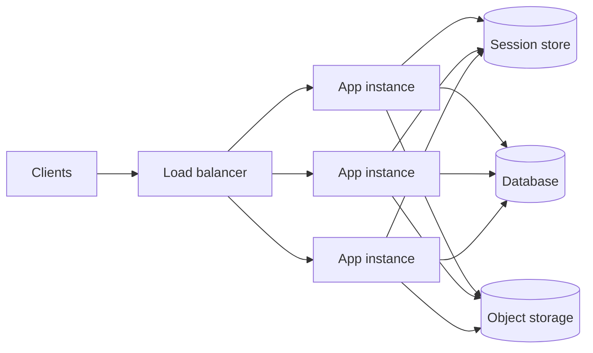

## The problem it solves

If a web server keeps a user's session or shopping cart in its own memory, that user has to keep hitting the same server. When that server restarts for a deploy, crashes or gets scaled away, the user's state disappears. Load balancing becomes uneven, autoscaling becomes risky, and every deploy logs people out.

## How it works

Push all durable or shared state **out** of the service process, into systems built to hold it:

| State | Where it goes |
|---|---|
| User sessions | Redis/Memcached, a database, or a signed token held by the client |
| Uploaded files | Object storage such as S3 |
| Business data | The database |
| Background work | A queue |
| Config and secrets | Environment variables or a config service |

After that, every instance is identical and interchangeable. The [load balancer](/principles/load-balancing) can send any request to any instance, and instances can be added or removed at any moment.

### Session options

- **Server-side session store:** the client holds a random session ID; the data lives in Redis. Easy to revoke, but every request needs a lookup.
- **Signed tokens (e.g. JWT):** the client holds a signed blob with the claims. No lookup needed, but revoking a token before it expires needs extra machinery such as short expiry plus refresh tokens or a deny-list.

### Local state that's still fine

Stateless doesn't mean "no memory". Caches of data that can be re-fetched, connection pools and compiled templates are fine because losing them only costs speed, not correctness.

## Trade-offs

- **Extra network hops.** Fetching a session from Redis on every request adds about a millisecond and a dependency. Cache it per request, and keep the session small.
- **The state still exists somewhere.** You've moved the hard problem to the database or cache, which now has to scale and stay available.
- **Sticky sessions are a shortcut, not a solution.** Pinning users to instances works until an instance dies, and makes load uneven.
- **Some workloads are inherently stateful.** WebSocket connections, game servers and stream processors hold state on purpose; they need draining and rebalancing strategies rather than pretending to be stateless.

## In the real world

<Callout type="example" title="The Twelve-Factor App">
Heroku's Twelve-Factor App methodology, written in 2011 and still widely followed, states that processes should be stateless and share-nothing: any data that needs to persist goes in a backing service such as a database. It explicitly calls sticky sessions a violation. The reason is practical: Heroku could restart or move any process at any time, so apps that kept state in memory broke.
</Callout>

Large cloud deployments rely on the same idea. Instances are treated as disposable ("cattle, not pets"): replaced rather than repaired, and scaled by an [autoscaler](/principles/autoscaling) without anyone logging in.

## Interview angle

<Callout type="interview">
When you draw the app tier, say "these servers are stateless; sessions live in Redis and files in object storage", so scaling the tier is just adding instances. If the design has WebSockets or other long-lived connections, call out that those servers are stateful and explain how you'd drain them during deploys.
</Callout>

- Storing uploads on the app server's local disk.
- Relying on sticky sessions for correctness.
